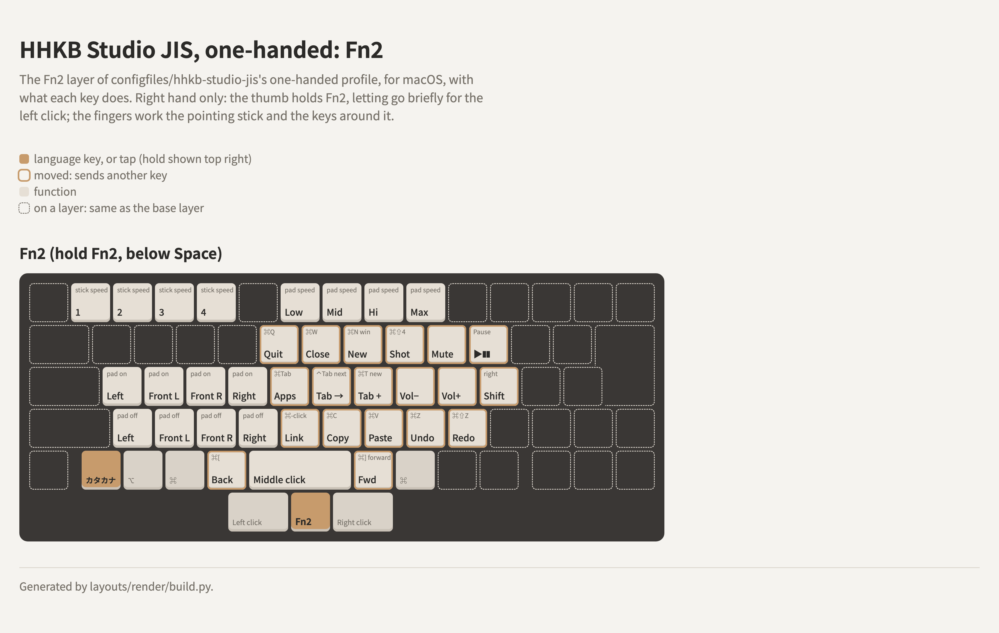

# HHKB Studio JIS: the golden layout for macOS, two options

Single profiles for an **HHKB Studio JIS** (`PD-ID120B`, stock firmware, USB `04FE:0015`), for
PFU's HHKB Studio Keymap Tool (1.1.2). Both are the
[golden layout](../../layouts/hhkb-jis-golden/README.md)'s Profile1 with keys added on Fn2
(`KeyHHKBFunctionTwo`), for macOS. Both were exported from the owner's board on 2026-10-26 with
**Single** save type: one profile, not all four.

| File | Adds |
|---|---|
| [hhkb-studio-jis.hks](hhkb-studio-jis.hks) | Back and Forward on Fn2 + 英数 / かな |
| [hhkb-studio-jis-one-handed.hks](hhkb-studio-jis-one-handed.hks) | The same, plus the common ⌘ shortcuts, app and tab switching, a screenshot key, media keys and a pinky Shift on Fn2, for one-handed use with the pointing stick |

## Back and Forward (both files)

| Fn2 + | Sends | Code in the file | Does on macOS |
|---|---|---|---|
| 英数 (`KeyJISMacEnglish`) | Right ⌘ (`KeyRightPrimary`) + `KeyHandakuten` (`[` on JIS) | 6192 (0x1830) | Back (⌘[) |
| かな (`KeyJISMacKana`) | Right ⌘ (`KeyRightPrimary`) + `KeyMu` (`]` on JIS) | 6194 (0x1832) | Forward (⌘]) |

Back sits on the left and Forward on the right, under the thumbs, next to the pointing-stick
buttons. ⌘[ / ⌘] is macOS's closest thing to a universal Back / Forward, and it needs no
Karabiner-Elements; mouse buttons 4 and 5 (`KeyMouseButtonFour` / `KeyMouseButtonFive`) would be
ideal, but Safari and Finder ignore them without a remapper.

The keys are the JIS positions of `[` and `]` (HID 0x30 and 0x32), so the keyboard must be stored
by macOS as **JIS**, see [studio-jis-stored-as-ansi](../../hhkb/studio-jis-stored-as-ansi/README.md).
Stored as ANSI, the same codes are ⌘] and ⌘\\.

### Where it works *(tested on macOS 27.0.1, 2026-10-26)*

| App | Back / Forward |
|---|---|
| Google Chrome | works |
| Finder | works |
| Claude (desktop) | works |
| Discord | works |
| Signal | doesn't |
| YouTube Music (PWA) | works; other PWAs likely do too |
| VS Code | doesn't; ⌘[ / ⌘] there are Outdent / Indent Line |

## One-handed (hhkb-studio-jis-one-handed.hks)

<picture>
  <source media="(prefers-color-scheme: dark)" srcset="one-handed-fn2-dark.png">
  
</picture>

The drawing is [one-handed-fn2.html](one-handed-fn2.html), from
[layouts/render/build.py](../../layouts/render/build.py).

It all takes only the right hand. The thumb holds Fn2 (below Space), letting go of it briefly to
press the left button next to it; the fingers work the pointing stick and the keys around it
(T Y U I O P, G H J K L ;, B N M , .):

| Fn2 + | Sends | Code in the file | Does on macOS |
|---|---|---|---|
| T (`KeyT`) | Right ⌘ + Q | 6164 (0x1814) | Quit |
| Y (`KeyY`) | Right ⌘ + W | 6170 (0x181A) | Close window or tab |
| U (`KeyU`) | Right ⌘ + N | 6161 (0x1811) | New window |
| I (`KeyI`) | Print Screen (`KeyPrintScreen`) | 70 (0x46) | Screenshot of a selection (⌘⇧4), with Karabiner-Elements (below) |
| O (`KeyO`) | Mute (`KeyMute`) | 168 | Mute |
| P (`KeyP`) | Pause (`KeyPause`) | 72 (0x48) | Play / Pause, with Karabiner-Elements (below) |
| G (`KeyG`) | ⌘Tab, left | 24462 (0x5F8E) | Switch app |
| H (`KeyH`) | Right Control (`KeyRightControl`) + Tab (`KeyTab`) | 4395 (0x112B) | Next tab |
| J (`KeyJ`) | Right ⌘ + T | 6167 (0x1817) | New tab |
| K (`KeyK`) | Volume down (`KeyVolumeDown`) | 170 | Volume down |
| L (`KeyL`) | Volume up (`KeyVolumeUp`) | 169 | Volume up |
| ; (`KeyRe`) | Right Shift (`KeyRightShift`) | 229 | Shift, for the right pinky while Fn2 is held |
| B (`KeyB`) | Right ⌘ + left click (`KeyLeftMouseButton`) | 6388 (0x18F4) | Open a link in a new tab |
| N (`KeyN`) | Right ⌘ + C | 6150 (0x1806) | Copy |
| M (`KeyM`) | Right ⌘ + V | 6169 (0x1819) | Paste |
| , (`KeyNe`) | Right ⌘ + Z | 6173 (0x181D) | Undo |
| . (`KeyRu`) | Right ⌘ + Shift + Z | 6685 (0x1A1D) | Redo |

⌘Tab left and right are the tool's own functions (24462 and 24463, the same codes the factory Mac
profile has at positions 108 and 109). A first version had ⌘Tab right on G and left on H, right
on the left key because of how macOS's app switcher works; in use the two made no meaningful
difference, so G kept ⌘Tab left and H became Control+Tab. Fn2+G and Fn2+B were the pointing
stick's faster / slower; its speed is still set with Fn2 + 1–4.

Also different from the other file: Fn1+T is set to T (code 23; it was 1), and **tap-to-click on
the pointing stick is off** (`"PointingStickButton": false`). That's a preference: the owner's
stick has an aftermarket red cap, and with it a tap almost never registers as a click, so it's off
for consistency; the stick's left and right buttons below Space click.

### Karabiner-Elements, for Fn2 + I and P

The firmware can't send ⌘⇧4 or Play / Pause there, so it sends Print Screen and Pause, and
Karabiner-Elements turns them into those. Without it, macOS sees F13 and F15. The owner's rules:

- **Print Screen → ⌘⇧4**, a complex modification with no device condition, so it works on every
  keyboard Karabiner modifies (added 2026-10-26; before that no rule covered the Studio, so
  Print Screen did nothing useful):

  ```json
  { "description": "Print Screen → ⌘⇧4 (screenshot of a selection), on every keyboard",
    "manipulators": [{ "type": "basic",
      "from": { "key_code": "print_screen", "modifiers": { "optional": ["any"] } },
      "to": [{ "key_code": "4", "modifiers": ["left_command", "left_shift"] }] }] }
  ```

- **Pause → Play / Pause**, also with no device condition (added 2026-10-26; before that it was a
  simple modification in Karabiner's device settings for the Studio, `04FE:0015`, which is still
  there and does the same):

  ```json
  { "description": "Pause → Play/Pause, on every keyboard",
    "manipulators": [{ "type": "basic",
      "from": { "key_code": "pause", "modifiers": { "optional": ["any"] } },
      "to": [{ "consumer_key_code": "play_or_pause" }] }] }
  ```

## The codes

How the tool writes a key with modifiers isn't documented. Read from these files: the low byte is
the key (a HID usage, or 244 / 245 / 246 for left / middle / right click), and the high byte the
modifiers, with 0x01 Control, 0x02 Shift, 0x08 ⌘ and 0x10 for the right-hand key. So 0x18 is
right ⌘, 0x1A right ⌘ + Shift, and 0x11 right Control. Codes from 24448 (0x5F80) up are the
tool's own functions (pointing-stick and gesture-pad settings, ⌘Tab).

## How to use

1. **Store the Studio as JIS** on the Mac (see above).
2. In the HHKB Studio Keymap Tool, pick the profile you want in the drop-down above the keymap
   preview, open one of the files and write it to the keyboard. It loads into that profile only,
   leaving the other three alone (tried on 2026-10-26). **Export your own keymap first** anyway.
   To put them in an All Profiles file with other profiles, use
   [hhkb-studio-profiles](../../utils/hhkb-studio-profiles/README.md) `merge`.
3. **DIP switches** are recorded in the files, but they're physical: on the owner's board only
   switch 6 is on (power saving off). Set them by hand.

Everything else is the golden layout's Profile1: gesture pads all off, the Standard, Fn1, Fn2 and
Fn3 layers as drawn there. [hhkb-studio-jis.hks](hhkb-studio-jis.hks) has tap-to-click on.
