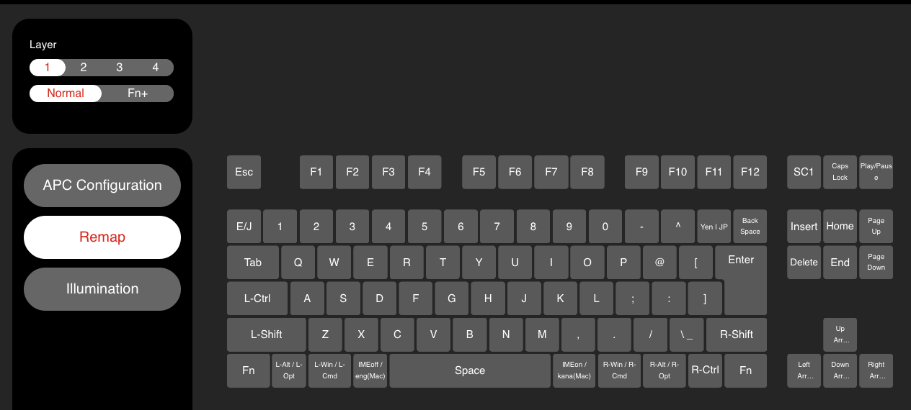
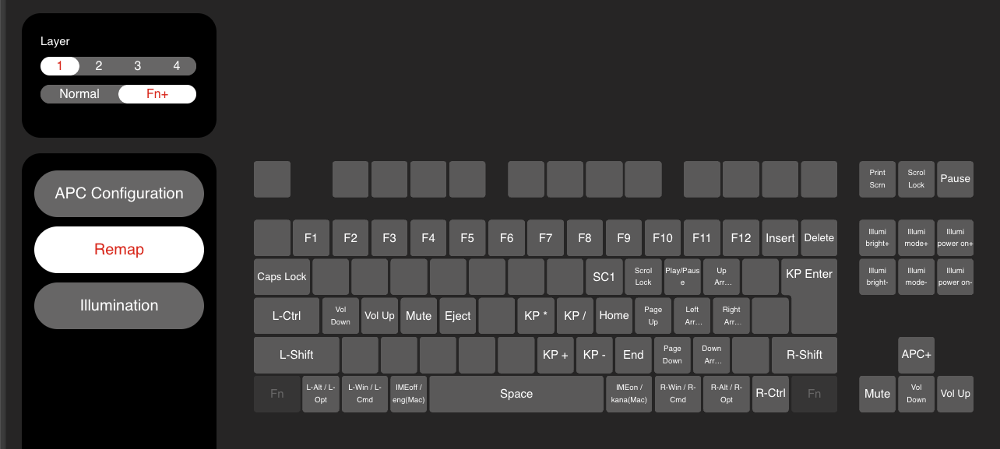

# REALFORCE X1P JP TKL: the owner's remap, layer 1

The remap on the owner's **REALFORCE X1P JP TKL** (Topre, JIS tenkeyless, model X1PC11, firmware
A1.13, USB `0853:0322`, reports as "REALFORCE X1P JP TKL"), as set in Topre's configuration tool
(Remap tab, layer 1). The tool has no JSON export, so this folder keeps its screenshots, and the
tables below transcribe them key by key.

| File | What |
|---|---|
| [layer1-normal.png](layer1-normal.png) | Layer 1, Normal |
| [layer1-fn.png](layer1-fn.png) | Layer 1, Fn+ (with Fn held) |

Only layer 1 was captured; layers 2 to 4 aren't recorded here. The tool's labels are quoted as it
shows them (it cuts some short, e.g. "Up Arr…", written out in full below). Key positions use
their canonical names from [KEYNAMES.md](../../conventions/keynames/REV1-20261025/KEYNAMES.md);
"SC1", "APC+" and the "Illumi" functions are the board's own and have no canonical name.

## Layer 1, Normal



Every key in the main block types its own legend: Esc, F1 to F12, the number row, the letters, the
JIS symbol keys (- ^ ¥ @ [ ; : ] , . / ろ), Tab, Enter, Backspace, both Shifts, Space, the
navigation block and the arrows. Left of A is Control. The keys worth noting:

| Position | Canonical name | Tool's label |
|---|---|---|
| Left of 1 | `KeyHankakuZenkaku` | E/J |
| ¥, right of ^ | `KeyLongKatakana` | Yen \| JP |
| ろ, left of right Shift | `KeyRo` | \ _ |
| Left of A | `KeyLeftControl` | L-Ctrl |
| Print Screen | `KeyPrintScreen` | SC1 |
| Scroll Lock | `KeyScrollLock` | Caps Lock |
| Pause | `KeyPause` | Play/Pause (sends `KeyMediaPlayPause`) |

The bottom row, left to right, with what each key sends:

| # | Tool's label | Sends |
|---|---|---|
| 1 | Fn | Fn (the board's own; holds the Fn+ layer below) |
| 2 | L-Alt / L-Opt | Left ⌥ (`KeyLeftAuxiliary`) |
| 3 | L-Win / L-Cmd | Left ⌘ (`KeyLeftPrimary`) |
| 4 | IMEoff / eng(Mac) | 無変換 (`KeyJISMuhenkan`) on Windows, 英数 (`KeyJISMacEnglish`) on macOS |
| 5 | Space | Space (`KeySpacebar`) |
| 6 | IMEon / kana(Mac) | 変換 (`KeyJISHenkan`) on Windows, かな (`KeyJISMacKana`) on macOS |
| 7 | R-Win / R-Cmd | Right ⌘ (`KeyRightPrimary`) |
| 8 | R-Alt / R-Opt | Right ⌥ (`KeyRightAuxiliary`) |
| 9 | R-Ctrl | Right Control (`KeyRightControl`) |
| 10 | Fn | Fn, as #1 |

So on a Mac the bottom row reads Fn, ⌥, ⌘, 英数, Space, かな, ⌘, ⌥, Control, Fn, and there's no
Caps Lock in the main block: it's in the Scroll Lock position, and on Fn + Tab.

## Layer 1, Fn+



With either Fn held. Keys the tool leaves blank do nothing with Fn: Esc, F1 to F12, E/J, Q to U,
[, G, ], Z to B and ろ. The modifiers and Space keep their Normal meaning.

**Main block:**

| Key | Canonical name | With Fn |
|---|---|---|
| 1 to 0, -, ^ | `KeyOne` … `KeyZero`, `KeyHo`, `KeyHe` | F1 to F12 (`KeyFunctionOne` … `KeyFunctionTwelve`) |
| ¥ | `KeyLongKatakana` | Insert (`KeyInsert`) |
| Backspace | `KeyDeleteLeft` | Delete (`KeyDeleteRight`) |
| Tab | `KeyTab` | Caps Lock (`KeyCapsLock`) |
| I | `KeyI` | SC1 |
| O | `KeyO` | Scroll Lock (`KeyScrollLock`) |
| P | `KeyP` | Play/Pause (`KeyMediaPlayPause`) |
| @ | `KeyDakuten` | Up Arrow (`KeyUpArrow`) |
| Enter | `KeyISOEnter` | Keypad Enter (`KeyNumpadEnter`) |
| A | `KeyA` | Volume Down (`KeyVolumeDown`) |
| S | `KeyS` | Volume Up (`KeyVolumeUp`) |
| D | `KeyD` | Mute (`KeyMute`) |
| F | `KeyF` | Eject (`KeyEject`) |
| H | `KeyH` | Keypad * (`KeyNumpadMultiply`) |
| J | `KeyJ` | Keypad / (`KeyNumpadDivide`) |
| K | `KeyK` | Home (`KeyHome`) |
| L | `KeyL` | Page Up (`KeyPageUp`) |
| ; | `KeyRe` | Left Arrow (`KeyLeftArrow`) |
| : | `KeyKe` | Right Arrow (`KeyRightArrow`) |
| N | `KeyN` | Keypad + (`KeyNumpadPlus`) |
| M | `KeyM` | Keypad - (`KeyNumpadMinus`) |
| , | `KeyNe` | End (`KeyEnd`) |
| . | `KeyRu` | Page Down (`KeyPageDown`) |
| / | `KeyMe` | Down Arrow (`KeyDownArrow`) |

So K L ; : , . / and @ form a cursor cluster for the right hand: @ is Up, ; / : / / are Left,
Right and Down, with Home / Page Up and End / Page Down beside them.

**Right-hand blocks:**

| Key | Canonical name | With Fn |
|---|---|---|
| Print Screen (SC1) | `KeyPrintScreen` | Print Screen (`KeyPrintScreen`) |
| Scroll Lock (Caps Lock) | `KeyScrollLock` | Scroll Lock (`KeyScrollLock`) |
| Pause | `KeyPause` | Pause (`KeyPause`) |
| Insert | `KeyInsert` | Illumi bright+ (lighting brighter) |
| Home | `KeyHome` | Illumi mode+ (next lighting mode) |
| Page Up | `KeyPageUp` | Illumi power on+ |
| Delete | `KeyDeleteRight` | Illumi bright- (lighting dimmer) |
| End | `KeyEnd` | Illumi mode- (previous lighting mode) |
| Page Down | `KeyPageDown` | Illumi power on- |
| Up | `KeyUpArrow` | APC+ |
| Left | `KeyLeftArrow` | Mute (`KeyMute`) |
| Down | `KeyDownArrow` | Volume Down (`KeyVolumeDown`) |
| Right | `KeyRightArrow` | Volume Up (`KeyVolumeUp`) |

## On macOS

The owner's Mac stores the board as JIS (keyboard type 42, entry `802-2131-0` in
`/Library/Preferences/com.apple.keyboardtype`), so ¥ and ろ type as on a Mac JIS keyboard. Set on
macOS 27 (Apple Silicon) on 2026-11-04 with:

```sh
sudo defaults write /Library/Preferences/com.apple.keyboardtype keyboardtype \
  -dict-add "802-2131-0" -int 42
```

Unplug and replug the board (or log out and in) for macOS to read the new type.
