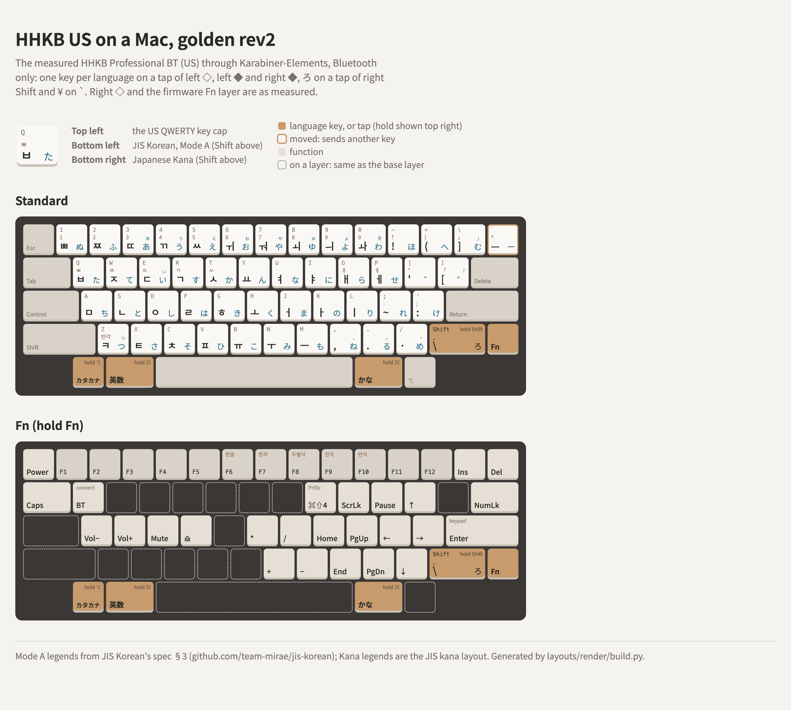

# The golden layout for an HHKB US on a Mac, rev2

The [measured](../../hhkb/key-legends/hhkb-us.md) HHKB Professional BT (US), in Mac Mode, with one
Karabiner-Elements rule on top: a language key each on a tap of the bottom row's modifiers, ろ on a
tap of right Shift, and ¥ on `` ` ``. Everything else, the firmware Fn layer included, is the board
as measured.

<picture>
  <source media="(prefers-color-scheme: dark)" srcset="layout-dark.png">
  
</picture>

The rule is [hhkb-bt-golden-rev2.json](hhkb-bt-golden-rev2.json), exported from the working
`karabiner.json`; the drawing is [layout.html](layout.html).

| HHKB key | Tap | Hold |
|---|---|---|
| Left ◇ (⌥) | カタカナ (`japanese_pc_katakana`) | ⌥ |
| Left ◆ (⌘) | 英数 | ⌘ |
| Right ◆ (⌘) | かな | ⌘ |
| Right Shift | ろ, with the \_ ろ rule (below) | Shift |
| `` ` `` / `~` | ¥ (ー in Kana) | |
| Right ◇ (⌥) | unchanged: ⌥ | |

- **Bluetooth only.** The rule matches vendor 1278, product 514, the HHKB-BT. The board had been
  set to be ignored by Karabiner, so that setting is now off for it. The USB HHKB-Hybrid is
  unchanged.
- **The rule goes first** in the list of complex modifications.
- **The \_ ろ rule, copied into right Shift.** Karabiner doesn't run a key one rule sends back
  through another rule, so the existing JIS ろ rule (`\` on ろ with a non-Japanese input source)
  can't see right Shift's tap. The tap does the same itself: Option+¥, which is `\`, with a
  non-Japanese input source, and ろ with Japanese or JIS Korean. The original rule still handles
  the physical ろ key on the other keyboards.
- **The Fn layer is firmware only** ([fn-layer-is-firmware-only](../../hhkb/fn-layer-is-firmware-only/README.md)),
  so it's the measured one. Fn+I sends Print Screen, which a global rule in the same profile turns
  into ⌘⇧4. The bottom row passes through Fn, so the language keys work while it's held.
- **DIP switches:** SW1 off, SW2 on (Mac Mode), SW6 on, the rest off, as measured.
- **Karabiner's virtual keyboard stored as JIS**, as for every layout here: see the
  [README](../../README.md).
