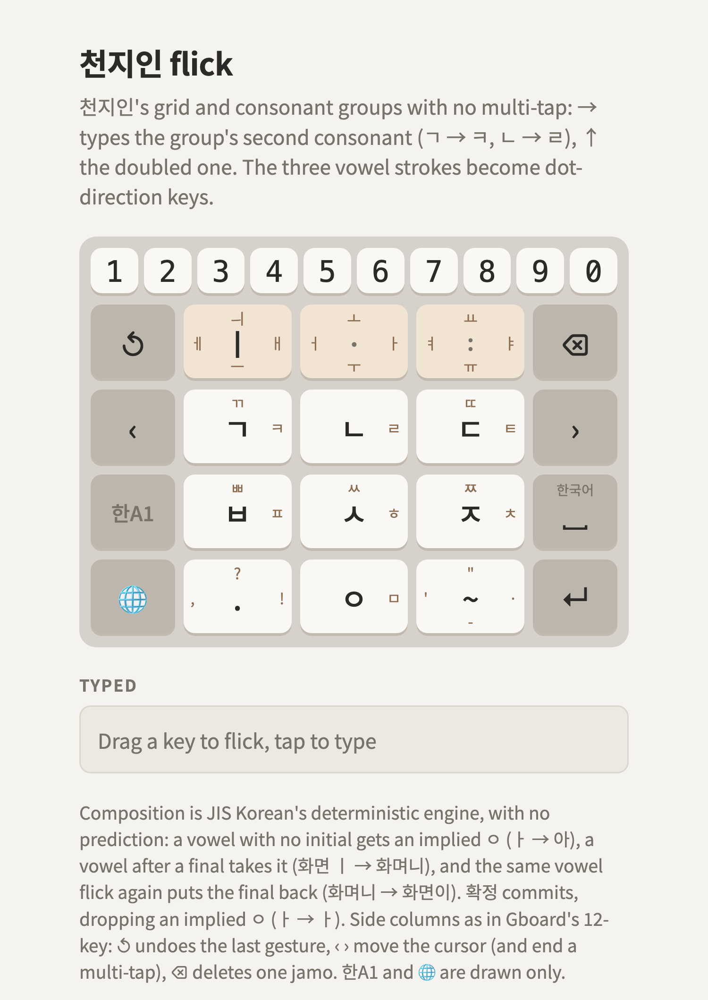

# Mobile Korean flick

Layouts for a Korean 12-key flick IME on a phone. Nothing here is an IME yet: each layout is a
drawing and a page you can type on. New layouts should follow the [principles](PRINCIPLES.md).

**[korean-flick-golden](korean-flick-golden/README.md) is the golden layout**, the reference for
the others: the double-clockwise candidate, with a 10 × 2 number section and an ortholinear A
(QWERTY) and 1 (JIS symbols) layer behind 한A1. The [candidates](#candidates) it was picked from
stay for comparison.

<picture>
  <source media="(prefers-color-scheme: dark)" srcset="korean-flick-golden/layout-dark.png">
  
</picture>

## The frame

Every candidate uses the shell of **Gboard's Japanese 12-key**, the reference: a function column
on each side of a 3×4 center.

| Left | Center | Right |
|---|---|---|
| ↺ undo the last gesture | 3 keys | ⌫ delete one jamo |
| ‹ cursor left | 3 keys | › cursor right |
| 한A1 mode | 3 keys | space (한국어) |
| 🌐 next keyboard | 3 keys | ↵ enter |

Space, backspace and the cursor live in the side columns, so all 12 center keys are free for
Korean. That's the room the first 3×3 drafts in the *Dubeolsik Letter Block* artifact didn't have:
they gave up center keys to space and backspace and left ㅣ ㅡ ㅐ ㅔ unassigned. A candidate defines
only the center and, optionally, a digit row on top.

A center key has up to five outputs: a tap and four flicks (← ↑ → ↓), drawn in the middle and at
the four edges.

## Composition

All candidates, the references too, compose with JIS Korean's deterministic engine, with no
prediction or learning ([principle 3](PRINCIPLES.md#3-composition-jis-koreans-deterministic-engine)):
a vowel with no initial gets an implied ㅇ (ㅏ → 아), a vowel after a final takes it (화면 + ㅣ →
화며니, not 화면이), and repeating the vowel flick puts the final back (화면이). Where a candidate has
a spare key, it's **확정**, JIS Korean's F6 (`KeyFunctionSix`): commit, dropping an implied ㅇ (ㅏ 확정 → ㅏ).

## Candidates

**All dropped**, kept for reference only. Their documentation is imperfect: some of it may
not match the pages, and some composition notes predate implied ㅇ and 확정.

| Candidate | Kind | Idea | 확정 | Status |
|---|---|---|---|---|
| [double-opposite](candidates/double-opposite/README.md) | From the artifact (6A) | Doubled consonant opposite its single: ㄱ ← / ㄲ → | yes | dropped |
| [double-clockwise](candidates/double-clockwise/README.md) | From the artifact (6B) | Doubled consonant 90° clockwise: ㄱ ← / ㄲ ↑ | yes | promoted to golden, then dropped |
| [double-up-aspirated-left](candidates/double-up-aspirated-left/README.md) | From the artifact (6C) | Single ↓, doubled ↑, aspirated ← | yes | dropped |
| [cheonjiin-flick](candidates/cheonjiin-flick/README.md) | New | 천지인's grid with every multi-tap turned into a flick | no spare key | dropped |
| [kana-mirror](candidates/kana-mirror/README.md) | New | The kana grid key for key, a flick types a whole syllable | no spare key | dropped |
| [cheonjiin](candidates/cheonjiin/README.md) | Reference | 천지인, multi-tap | yes, on its second space key | dropped |
| [naratgeul](candidates/naratgeul/README.md) | Reference | 나랏글, multi-tap with 획추가 / 쌍자음 | no spare key | dropped |

<table>
<tr>
<td><a href="candidates/double-opposite/README.md"></a></td>
<td><a href="candidates/cheonjiin-flick/README.md"></a></td>
<td><a href="candidates/kana-mirror/README.md"></a></td>
</tr>
</table>

## Building

Each layout is `korean-flick-golden/layout.json` or `candidates/<name>/layout.json`. The page and
its drawings are generated:

```sh
python3 -I layouts-mobile-korean-flick/render/build.py   # <name>/layout.html
sh layouts-mobile-korean-flick/render/render.sh          # layout-light.png and layout-dark.png, with Google Chrome
```

[render/build.py](render/build.py) documents the key format. The Hangul composer, flick handling
and cursor moves in [render/template.html](render/template.html) come from the artifact.

Open a `layout.html` in a browser and drag from a key to flick.
