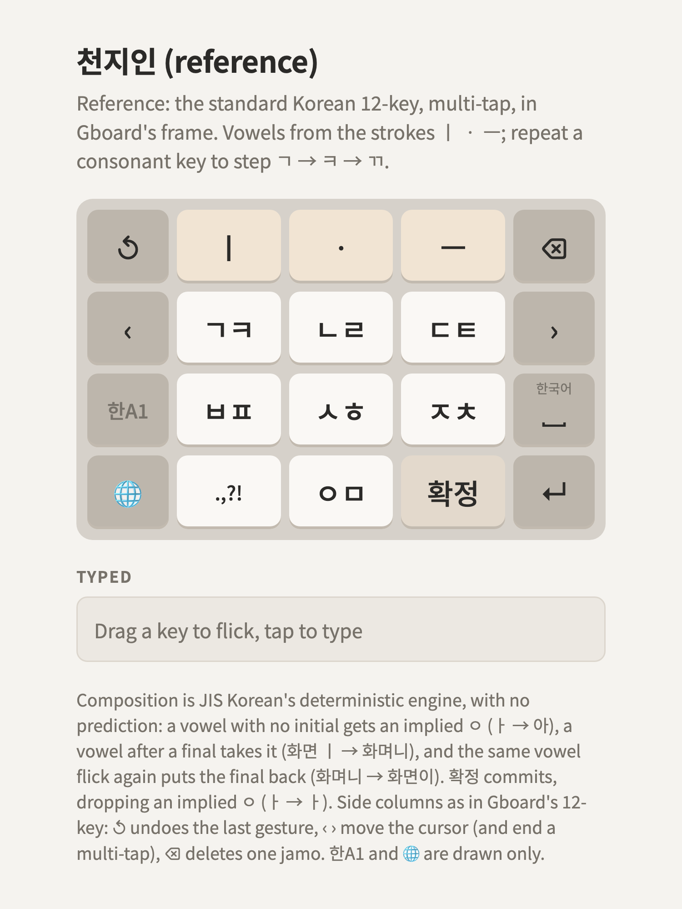

# 천지인 (reference)

> **Dropped.** Kept for reference only. This documentation is imperfect: it may not match the
> page, and some composition notes predate implied ㅇ and 확정. The
> [golden layout](../../korean-flick-golden/README.md) is the reference.

**A reference, not a proposal.** 천지인 (Cheonjiin), the 12-key layout most Korean phone typists
know, in [the frame](../../README.md#the-frame), so the candidates can be compared with it. It's
the artifact's Board 4.

<picture>
  <source media="(prefers-color-scheme: dark)" srcset="layout-dark.png">
  
</picture>

Try it: [layout.html](layout.html). Keys are [layout.json](layout.json).

## Keys

| Row | | | |
|---|---|---|---|
| 1 | ㅣ | ㆍ | ㅡ |
| 2 | ㄱ ㅋ (ㄲ) | ㄴ ㄹ | ㄷ ㅌ (ㄸ) |
| 3 | ㅂ ㅍ (ㅃ) | ㅅ ㅎ (ㅆ) | ㅈ ㅊ (ㅉ) |
| 4 | . , ? ! | ㅇ ㅁ | space |

- **Vowels are built from three strokes**, 하늘 (ㆍ), 땅 (ㅡ) and 사람 (ㅣ), in writing order: ㅣ ㆍ is
  ㅏ, ㆍ ㅣ is ㅓ, ㆍ ㆍ ㅣ is ㅕ, ㆍ ㅡ is ㅗ, ㅡ ㆍ is ㅜ, ㅏ ㅣ is ㅐ, and so on.
- **A consonant key cycles on repeat taps**: ㄱ, ㅋ, ㄲ.
- The space key stays in row 4 as on a 천지인 phone; the frame's space works too.

No flicks: every key is a tap.

## Why it's here

- It's the baseline: a new candidate should be faster than 천지인 or easier to learn than it.
- **Multi-tap needs a break.** ㄱ twice is ㅋ, so 각 needs › (or, on a phone, a timeout) between the
  two ㄱ. That's what the [principles](../../PRINCIPLES.md) call out, and what
  [cheonjiin-flick](../cheonjiin-flick/README.md) removes.
- Vowels take two to four strokes (ㅕ is ㆍ ㆍ ㅣ), the price of having only three vowel keys.

## Typing

| Text | Taps |
|---|---|
| 한글 | ㅅ ㅅ (ㅎ) · ㅣ ㆍ (ㅏ) · ㄴ · ㄱ · ㅡ · ㄴ ㄴ (ㄹ) |
| 까치 | ㄱ ㄱ ㄱ (ㄲ) · ㅣ ㆍ · ㅈ ㅈ (ㅊ) · ㅣ |
| 뭐해 | ㅇ ㅇ (ㅁ) · ㅡ ㆍ ㆍ ㅣ (ㅝ) · ㅅ ㅅ · ㅣ ㆍ ㅣ (ㅐ) |
