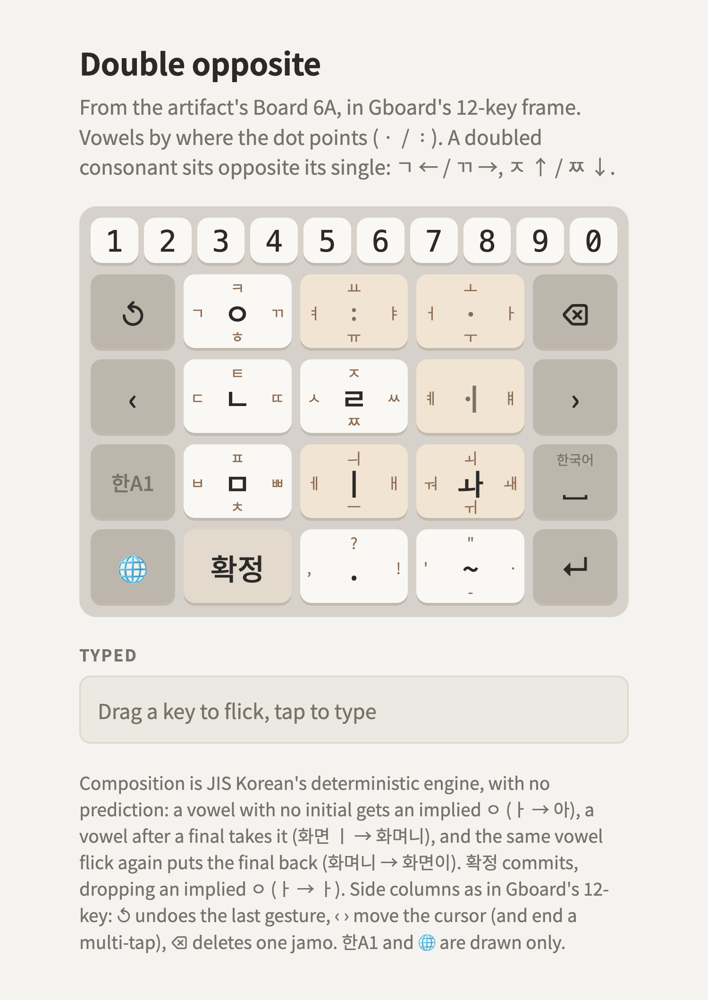

# Double opposite

> **Dropped.** Kept for reference only. This documentation is imperfect: it may not match the
> page, and some composition notes predate implied ㅇ and 확정. The
> [golden layout](../../korean-flick-golden/README.md) is the reference.

**From the artifact's Board 6A**, the *Dubeolsik Letter Block* draft, moved into
[the frame](../../README.md#the-frame). **A doubled consonant sits opposite its single**: ㄱ ← / ㄲ →, ㄷ ← / ㄸ →, ㅂ ← / ㅃ →, ㅅ ← / ㅆ →, and ㅈ ↑ / ㅉ ↓.

<picture>
  <source media="(prefers-color-scheme: dark)" srcset="layout-dark.png">
  
</picture>

Try it: [layout.html](layout.html). Keys are [layout.json](layout.json).

## Keys

Legends are tap, ←, ↑, →, ↓; — where a direction types nothing.

| | Tap | ← | ↑ | → | ↓ |
|---|---|---|---|---|---|
| **ㅇ** (row 1) | ㅇ | ㄱ | ㅋ | ㄲ | ㅎ |
| **ᆢ** (row 1) | — | ㅕ | ㅛ | ㅑ | ㅠ |
| **ㆍ** (row 1) | — | ㅓ | ㅗ | ㅏ | ㅜ |
| **ㄴ** (row 2) | ㄴ | ㄷ | ㅌ | ㄸ | — |
| **ㄹ** (row 2) | ㄹ | ㅅ | ㅈ | ㅆ | ㅉ |
| **ㆎ** (row 2) | — | ㅖ | — | ㅒ | — |
| **ㅁ** (row 3) | ㅁ | ㅂ | ㅍ | ㅃ | ㅊ |
| **ㅣ** (row 3) | ㅣ | ㅔ | ㅢ | ㅐ | ㅡ |
| **ㅘ** (row 3) | ㅘ | ㅝ | ㅚ | ㅙ | ㅟ |
| **확정** (row 4) | 확정 (commit) | — | — | — | — |
| **.** (row 4) | . | , | ? | ! | — |
| **~** (row 4) | ~ | ' | " | · | - |

A digit row 1–0 sits on top, as in the draft.

## Consonants

The four consonant keys are the draft's keys 1, 4, 5 and 7. Tap gives ㅇ, ㄴ, ㄹ, ㅁ. The single is always ← (or ↑ for ㅈ), its double the opposite way, the aspirated form ↑ (ㅋ, ㅌ, ㅍ), and ㅎ / ㅊ ↓. ㄴ ↓ is free.

## Vowels

From the draft, unchanged:

- **ㆍ** (the dot): the vowel goes where the dot points. ㅓ ←, ㅗ ↑, ㅏ →, ㅜ ↓.
- **ᆢ** (two dots): the same for the y-vowels. ㅕ ←, ㅛ ↑, ㅑ →, ㅠ ↓.
- **ㆎ**: ㅖ ←, ㅒ →. The draft's legend was `:|`. ㆎ (U+318E, ㆍ with ㅣ) heads the 훈민정음
  해례's list of vowels combined with ㅣ (中聲解: 一字中聲之與ㅣ相合者十), the family ㅐ ㅔ ㅒ ㅖ belong to.

New here, filling what the draft left unassigned:

- **ㅣ**: tap ㅣ; ㅔ ← and ㅐ → (the dot on the side the ㅓ / ㅏ dot is), ㅡ ↓, ㅢ ↑.
- **ㅘ** (compound vowels; the draft's 겹): tap ㅘ. ㅝ ←, ㅚ ↑, ㅙ →,
  ㅟ ↓. ㅝ goes where its second vowel's dot points (ㅓ ←), ㅚ and ㅟ where their first one's does
  (ㅗ ↑, ㅜ ↓), and ㅙ, ㅘ with ㅣ added, takes the → ㅘ used to have. ㅞ has no gesture of its own
  (ㅜ + ㅔ). Every compound also comes from composition (ㅗ + ㅏ → ㅘ): the key is a shortcut.

## Bottom row (new)

- **확정**: JIS Korean's F6 (`KeyFunctionSix`). Commits what's being composed, and drops an implied ㅇ while its
  syllable has no final: ㅏ 확정 → ㅏ, 가어 확정 → 가ㅓ, 안 확정 → 안. It's in the slot where the kana
  keyboard has ゛゜小, the spare key: a 획·쌍 cycle key there would only repeat what the flicks
  already type.
- **. , ? !** and **~ ' " · -**: punctuation, on the key where the kana keyboard has 、。?!.

## Composition

JIS Korean's deterministic engine, as on every candidate
([principle 3](../../PRINCIPLES.md#3-composition-jis-koreans-deterministic-engine)): a vowel with no
initial gets an implied ㅇ, so ㆍ→ alone is 아; a vowel after a final takes it (화면 ㅣ → 화며니);
the same vowel flick again right away puts the final back (화며니 ㅣ → 화면이); ㅘ from its key never
combines further (고 then ㅘ → 고와).

## Typing

| Text | Gestures |
|---|---|
| 아 / ㅏ | ㆍ→ / ㆍ→ · 확정 |
| 화며니 / 화면이 | …ㄴ · ㅣ / …ㄴ · ㅣ · ㅣ |
| 한글 | ㅇ↓ (ㅎ) · ㆍ→ (ㅏ) · ㄴ · ㅇ← (ㄱ) · ㅣ↓ (ㅡ) · ㄹ |
| 까치 | ㅇ→ (ㄲ) · ㆍ→ · ㅁ↓ (ㅊ) · ㅣ |
| 뭐해 | ㅁ · ㅘ← (ㅝ) · ㅇ↓ · ㅣ→ (ㅐ) |
| 없어 | ㅇ · ㆍ← · ㅁ← (ㅂ) · ㄹ← (ㅅ) · ㅇ · ㆍ← |

## Open questions

- The ᆢ, ㆍ and ㆎ keys have no tap. Candidates: ㆍ tap = ㅏ (the most frequent vowel), or the tap
  repeats the last vowel's direction.
- Whether ㅞ gets a flick (it's ㅜ + ㅔ for now), and whether ㅣ's ↑ should be ㅢ or move to the ㅘ key.
- Whether the digit row stays, now that 한A1 can switch to a number layer.
