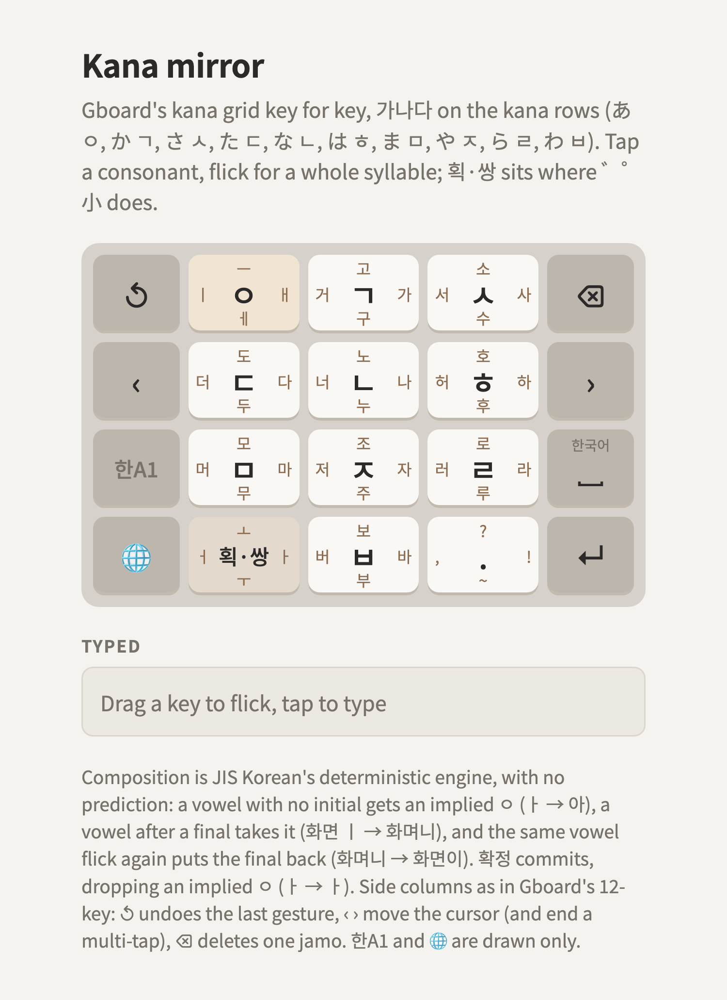

# Kana mirror

> **Dropped.** Kept for reference only. This documentation is imperfect: it may not match the
> page, and some composition notes predate implied ㅇ and 확정. The
> [golden layout](../../korean-flick-golden/README.md) is the reference.

**New.** The reference, Gboard's Japanese 12-key, key for key: the ten consonant keys take the
places of the ten kana rows, the cycle key takes ゛゜小's place, punctuation stays where 、。?! is.
As in kana flick, **one flick types a whole syllable**: ㄱ → is 가.

<picture>
  <source media="(prefers-color-scheme: dark)" srcset="layout-dark.png">
  
</picture>

Try it: [layout.html](layout.html). Keys are [layout.json](layout.json).

## Keys

가나다 order lines up with the kana rows. Eight of the ten keys get the consonant that sounds like
their kana row: あ ㅇ, か ㄱ, さ ㅅ, た ㄷ, な ㄴ, は ㅎ, ま ㅁ, ら ㄹ. The two left over get the two
consonants left over: や ㅈ, わ ㅂ.

| Kana | | Tap | ← | ↑ | → | ↓ |
|---|---|---|---|---|---|---|
| あ | **ㅇ** | ㅇ | ㅣ | ㅡ | ㅐ | ㅔ |
| か | **ㄱ** | ㄱ | 거 | 고 | 가 | 구 |
| さ | **ㅅ** | ㅅ | 서 | 소 | 사 | 수 |
| た | **ㄷ** | ㄷ | 더 | 도 | 다 | 두 |
| な | **ㄴ** | ㄴ | 너 | 노 | 나 | 누 |
| は | **ㅎ** | ㅎ | 허 | 호 | 하 | 후 |
| ま | **ㅁ** | ㅁ | 머 | 모 | 마 | 무 |
| や | **ㅈ** | ㅈ | 저 | 조 | 자 | 주 |
| ら | **ㄹ** | ㄹ | 러 | 로 | 라 | 루 |
| ゛゜小 | **획·쌍** | cycle | ㅓ | ㅗ | ㅏ | ㅜ |
| わ | **ㅂ** | ㅂ | 버 | 보 | 바 | 부 |
| 、。?! | **.** | . | , | ? | ! | ~ |

No digit row: 한A1 switches to numbers, as on the reference.

## Rules

- **Tap a consonant** for a final (받침) or to start a syllable whose vowel isn't ㅓ ㅗ ㅏ ㅜ.
- **Flick a consonant** for that consonant + the vowel its dot points to: ← ㅓ, ↑ ㅗ, → ㅏ, ↓ ㅜ, as
  in the artifact's drafts.
- **ㅇ is the vowel key**, as あ is in kana: its flicks are bare vowels (ㅣ ㅡ ㅐ ㅔ) that join the
  syllable before them (그 is ㄱ, ㅇ↑).
- **획·쌍 is ゛゜小**: tap it to step what the last gesture typed. On a syllable it steps the
  consonant (가 → 카 → 까, 사 → 싸), on a bare vowel the vowel (ㅏ → ㅑ, ㅐ → ㅒ). ㄴ ㄹ ㅁ ㅇ ㅎ have
  no other forms, so on their syllables it steps the vowel (나 → 냐). Its flicks are the
  bare dot vowels, for compounds and for vowels after a tapped consonant (과 is ㄱ↑, 획·쌍→).

## Typing

| Text | Gestures |
|---|---|
| 한글 | ㅎ→ (하) · ㄴ · ㄱ · ㅇ↑ (ㅡ) · ㄹ |
| 까치 | ㄱ→ (가) · 획·쌍 · 획·쌍 (까) · ㅈ · 획·쌍 (ㅊ) · ㅇ← (ㅣ) |
| 뭐해 | ㅁ↓ (무) · 획·쌍← (ㅓ) · ㅎ · ㅇ→ (ㅐ) |
| 없어 | ㅇ · 획·쌍← (ㅓ) · ㅂ · ㅅ · ㅇ · 획·쌍← |
| 갸 | ㄱ · 획·쌍→ (ㅏ) · 획·쌍 (ㅑ) |

## Compared with the others

- Common syllables (가 나 다 고 소 무) are one gesture, where every other candidate takes two.
- The other vowels (ㅣ ㅡ ㅐ ㅔ and the y-vowels) take one or two gestures more, so 이 is two
  gestures (ㅇ, ㅇ←) and 갸 three.
- The aspirated and doubled consonants aren't on any key: they're 획·쌍 after the plain one, which
  breaks principle 1's "one gesture, one result" for them, the way ゛゜小 does for kana.
- Someone who types Japanese on the reference already knows where every key is.

## Open questions

- ㅣ's place: 이 and 의 are frequent, and ㅇ← for ㅣ means 이 is two gestures. A ㅇ flick could type 이
  instead, at the cost of bare ㅣ after another consonant.
- The punctuation key's ↓ (~ here) and whether 、。 should mean anything in Korean.
- ㅇ's tap could type 아, as あ does, with ㅇ itself on a flick; finals ㅇ would then be a flick.
