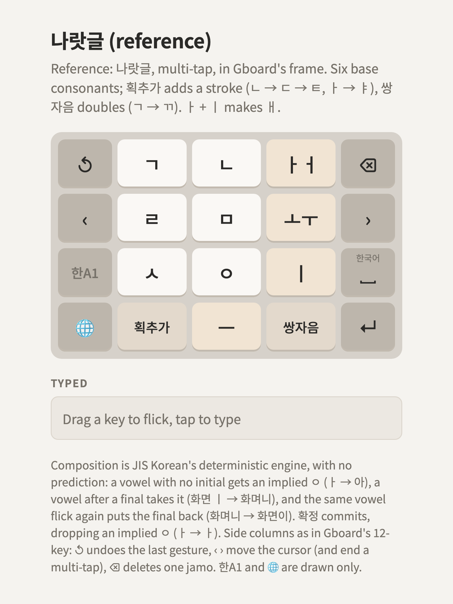

# 나랏글 (reference)

**A reference, not a proposal.** 나랏글 (Naratgeul), the other widely used Korean 12-key layout, in
[the frame](../../README.md#the-frame), drawn as it's commonly described. Its 획추가 key is the
model for the candidates' 획·쌍.

<picture>
  <source media="(prefers-color-scheme: dark)" srcset="layout-dark.png">
  
</picture>

Try it: [layout.html](layout.html). Keys are [layout.json](layout.json).

## Keys

| Row | | | |
|---|---|---|---|
| 1 | ㄱ | ㄴ | ㅏ ㅓ |
| 2 | ㄹ | ㅁ | ㅗ ㅜ |
| 3 | ㅅ | ㅇ | ㅣ |
| 4 | 획추가 | ㅡ | 쌍자음 |

- **Six base consonants.** The rest are a stroke away: **획추가** turns ㄱ into ㅋ, ㄴ into ㄷ then
  ㅌ, ㅁ into ㅂ then ㅍ, ㅅ into ㅈ then ㅊ, ㅇ into ㅎ, and a vowel into its y-form (ㅏ → ㅑ).
- **쌍자음** doubles: ㄱ → ㄲ, ㄷ → ㄸ, ㅂ → ㅃ, ㅅ → ㅆ, ㅈ → ㅉ.
- **ㅏㅓ and ㅗㅜ toggle on repeat taps.**
- ㅐ is ㅏ + ㅣ, ㅔ ㅓ + ㅣ, ㅒ ㅑ + ㅣ, ㅖ ㅕ + ㅣ.
- Punctuation isn't on the center; it's on 한A1's other layer, not drawn.

## Why it's here

- 획추가 and 쌍자음 are modifier keys that act on the last jamo, like the kana keyboard's ゛゜小. The
  candidates' 획·쌍 is one key doing both.
- It shows the cost: ㅌ is three taps (ㄴ, 획추가, 획추가), and every aspirated or doubled consonant
  takes at least two.

## Typing

| Text | Taps |
|---|---|
| 한글 | ㅇ 획추가 (ㅎ) · ㅏㅓ · ㄴ · ㄱ · ㅡ · ㄹ |
| 까치 | ㄱ 쌍자음 (ㄲ) · ㅏㅓ · ㅅ 획추가 획추가 (ㅊ) · ㅣ |
| 뭐해 | ㅁ · ㅗㅜ ㅗㅜ (ㅜ) · ㅏㅓ ㅏㅓ (ㅓ, ㅝ) · ㅇ 획추가 · ㅏㅓ · ㅣ (ㅐ) |

Implementations differ in details (where punctuation and space sit, what happens on ㅋ + 획추가);
this page follows the common description, not a specific phone's.
