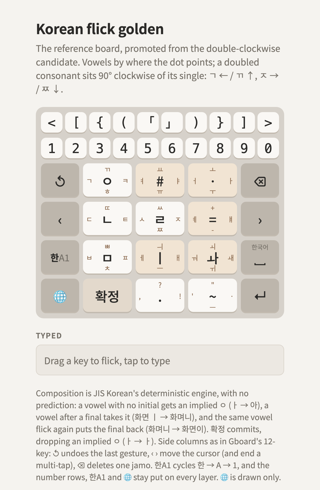
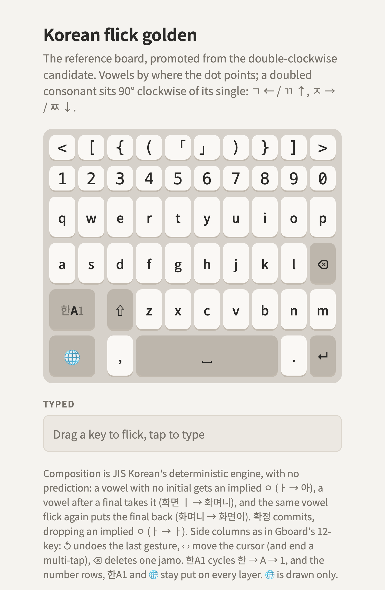
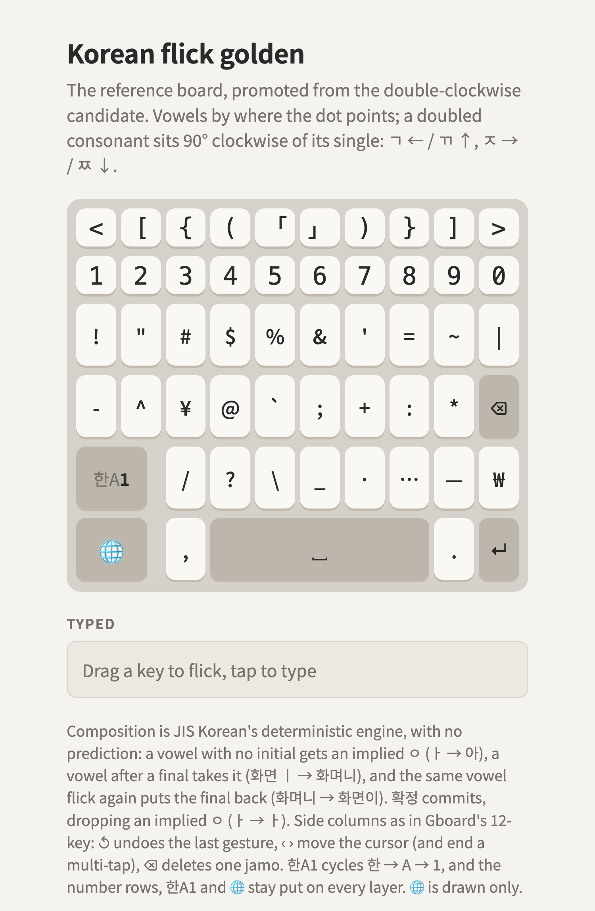

# The golden layout for mobile Korean flick

**The reference board** for [`layouts-mobile-korean-flick/`](../README.md), promoted from the
[double-clockwise](../candidates/double-clockwise/README.md) candidate, which stays as it was
promoted. New mobile layouts should start from this one and follow the [principles](../PRINCIPLES.md).

It began as the artifact's Board 6B, the *Dubeolsik Letter Block* draft, in
[the frame](../README.md#the-frame). **A doubled consonant sits 90° clockwise of its single**:
ㄱ ← / ㄲ ↑, ㄷ ← / ㄸ ↑, ㅂ ← / ㅃ ↑, ㅅ ← / ㅆ ↑, and ㅈ → / ㅉ ↓.

<picture>
  <source media="(prefers-color-scheme: dark)" srcset="layout-dark.png">
  
</picture>

Try it: [layout.html](layout.html). Keys are [layout.json](layout.json).

## Keys

Legends are tap, ←, ↑, →, ↓; — where a direction types nothing.

| | Tap | ← | ↑ | → | ↓ |
|---|---|---|---|---|---|
| **ㅇ** (row 1) | ㅇ | ㄱ | ㄲ | ㅋ | ㅎ |
| **#** (row 1) | # | ㅕ | ㅛ | ㅑ | ㅠ |
| **ㆍ** (row 1) | · | ㅓ | ㅗ | ㅏ | ㅜ |
| **ㄴ** (row 2) | ㄴ | ㄷ | ㄸ | ㅌ | — |
| **ㄹ** (row 2) | ㄹ | ㅅ | ㅆ | ㅈ | ㅉ |
| **=** (row 2) | = | ㅖ | + | ㅒ | - |
| **ㅁ** (row 3) | ㅁ | ㅂ | ㅃ | ㅍ | ㅊ |
| **ㅣ** (row 3) | ㅣ | ㅔ | ㅢ | ㅐ | ㅡ |
| **ㅘ** (row 3) | ㅘ | ㅝ | ㅚ | ㅙ | ㅟ |
| **확정** (row 4) | 확정 (commit) | — | — | — | — |
| **.** (row 4) | . | , | ? | ! | — |
| **~** (row 4) | ~ | ' | " | · | — |

On top, a 10 × 2 number section: a symbol row, then the digits 1–0 as in the draft.

| < | [ | { | ( | 「 | 」 | ) | } | ] | > |
|---|---|---|---|---|---|---|---|---|---|
| 1 | 2 | 3 | 4 | 5 | 6 | 7 | 8 | 9 | 0 |

The brackets nest outward from the middle, each opener mirroring its closer: 「 」 in the center,
then ( ), { }, [ ] and < >.

## Consonants

The four consonant keys are the draft's keys 1, 4, 5 and 7. Tap gives ㅇ, ㄴ, ㄹ, ㅁ. Turn a flick a quarter clockwise to double it: ← to ↑, → to ↓. The aspirated forms sit → (ㅋ, ㅌ, ㅍ). ㄴ ↓ is free.

## Vowels

The flicks are the draft's; the taps and two labels are new here.

- **ㆍ** (the dot): the vowel goes where the dot points. ㅓ ←, ㅗ ↑, ㅏ →, ㅜ ↓. **Tap types the
  Korean middle dot ·** (U+00B7, 가운뎃점).
- **#** (two dots): the same for the y-vowels. ㅕ ←, ㅛ ↑, ㅑ →, ㅠ ↓. **Tap types #**, and # is
  also its label: the shape the two dots trace when flicked each way, two strokes on every side.
- **=**: ㅖ ← and ㅒ → (the draft's `:|` key). **Tap types =, ↑ +, ↓ -**: the symbols ride on the
  free directions, and the label names the tap.

- **ㅣ**: tap ㅣ; ㅔ ← and ㅐ → (the dot on the side the ㅓ / ㅏ dot is), ㅡ ↓, ㅢ ↑.
- **ㅘ** (compound vowels; the draft's 겹): tap ㅘ. ㅝ ←, ㅚ ↑, ㅙ →,
  ㅟ ↓. ㅝ goes where its second vowel's dot points (ㅓ ←), ㅚ and ㅟ where their first one's does
  (ㅗ ↑, ㅜ ↓), and ㅙ, ㅘ with ㅣ added, takes the → ㅘ used to have. ㅞ has no gesture of its own
  (ㅜ + ㅔ). Every compound also comes from composition (ㅗ + ㅏ → ㅘ): the key is a shortcut.

## Bottom row (new)

- **확정**: JIS Korean's F6. Commits what's being composed, and drops an implied ㅇ while its
  syllable has no final: ㅏ 확정 → ㅏ, 가어 확정 → 가ㅓ, 안 확정 → 안. It's in the slot where the kana
  keyboard has ゛゜小, the spare key: a 획·쌍 cycle key there would only repeat what the flicks
  already type.
- **. , ? !** and **~ ' " · —**: punctuation, on the key where the kana keyboard has 、。?!. ~'s ↓
  is an em dash (—, U+2014); the hyphen-minus is on =↓.

## Layers: 한, A, 1

**한A1** cycles the layers: 한 (this page's Korean), A (ortholinear QWERTY), 1 (symbols). Its
label shows the current one bright, the others dim, as Gboard's あa1 does. Switching commits the
syllable being composed (간, A, 한, ㅏ → 간아).

Nothing moves between layers: the 10 × 2 number section, 한A1 and 🌐 keep their place and size,
and the keyboard's height doesn't change. A and 1 use the rest of the space, on the number rows'
ten columns, so every key sits under a digit: rows 1 and 2 take all ten columns, rows 3 and 4 the
eight right of 한A1 and 🌐 (from column 3, under 3–0).

<picture>
  <source media="(prefers-color-scheme: dark)" srcset="layout-en-dark.png">
  
</picture>
<picture>
  <source media="(prefers-color-scheme: dark)" srcset="layout-sym-dark.png">
  
</picture>

**A** (open `layout.html?layer=en`):

| | 1 | 2 | 3 | 4 | 5 | 6 | 7 | 8 | 9 | 10 |
|---|---|---|---|---|---|---|---|---|---|---|
| Row 1 | q | w | e | r | t | y | u | i | o | p |
| Row 2 | a | s | d | f | g | h | j | k | l | ⌫ |
| Row 3 | 한A1 | | ⇧ | z | x | c | v | b | n | m |
| Row 4 | 🌐 | | , | space | | | | | . | ↵ |

**1** (`layout.html?layer=sym`):

| | 1 | 2 | 3 | 4 | 5 | 6 | 7 | 8 | 9 | 10 |
|---|---|---|---|---|---|---|---|---|---|---|
| Row 1 | ! | " | # | $ | % | & | ' | = | ~ | \| |
| Row 2 | - | ^ | ¥ | @ | \` | ; | + | : | * | ⌫ |
| Row 3 | 한A1 | | / | ? | \ | _ | · | … | — | ₩ |
| Row 4 | 🌐 | | , | space | | | | | . | ↵ |

- 한A1 and 🌐 are narrower than two columns (they keep the Korean layer's side-column width), so
  there's a sliver of gap before ⇧ / ? and , in rows 3 and 4.
- **⇧** is one-shot: it capitalizes the next letter and turns off. Space spans columns 4–8.
- **The symbols follow JIS, not US ANSI.** Row 1 is JIS Shift+1–7, each under its digit (! " # $
  % & '). JIS's Shift+8 and 9 are ( ), already on the number section, and Shift+0 types nothing,
  so the row goes on with Shift on the keys after 0 on JIS, - ^ ¥: = ~ |. Rows 2 and 3 are the
  rest of the JIS punctuation keys in key order, each unshifted then shifted: - ^ ¥, @ \`, ; +,
  : *, / ?, \ _. The JIS keys' [ { ] } are on the number section and , < . > are , and . in row 4
  (< > on the number section). Then Korean · … — and ₩.
- ¥ is U+00A5, the yen sign, as JIS prints it.
- ↺, ‹ and › are on the Korean layer only.

## Composition

**The full rules and 70 test cases are in [COMPOSITION.md](COMPOSITION.md).** In short, JIS
Korean's deterministic engine
([principle 3](../PRINCIPLES.md#3-composition-jis-koreans-deterministic-engine)), with no
prediction: a vowel with no initial gets an implied ㅇ, so ㆍ→ alone is 아; a vowel after a final
takes it (화면 ㅣ → 화며니); the same vowel flick again right away puts the final back (화며니 ㅣ →
화면이); ㅘ from its key never combines further (고 then ㅘ → 고와). Text stays unconfirmed until
확정, space, ↵, 한A1 or a cursor move commits it.

## Typing

| Text | Gestures |
|---|---|
| 아 / ㅏ | ㆍ→ / ㆍ→ · 확정 |
| 화며니 / 화면이 | …ㄴ · ㅣ / …ㄴ · ㅣ · ㅣ |
| 한글 | ㅇ↓ (ㅎ) · ㆍ→ (ㅏ) · ㄴ · ㅇ← (ㄱ) · ㅣ↓ (ㅡ) · ㄹ |
| 까치 | ㅇ↑ (ㄲ) · ㆍ→ · ㅁ↓ (ㅊ) · ㅣ |
| 뭐해 | ㅁ · ㅘ← (ㅝ) · ㅇ↓ · ㅣ→ (ㅐ) |
| 없어 | ㅇ · ㆍ← · ㅁ← (ㅂ) · ㄹ← (ㅅ) · ㅇ · ㆍ← |

## Open questions

- · is on both ㆍ's tap and ~'s →, so ~'s → is free for something else.
- On A: caps lock (a double tap on ⇧?), and whether ' and - belong on the letter layer, as on
  Gboard.
- Whether A and 1 should get ↺ and cursor keys, for example by sliding on space.
- Whether ㅞ gets a flick (it's ㅜ + ㅔ for now), and whether ㅣ's ↑ should be ㅢ or move to the ㅘ key.
