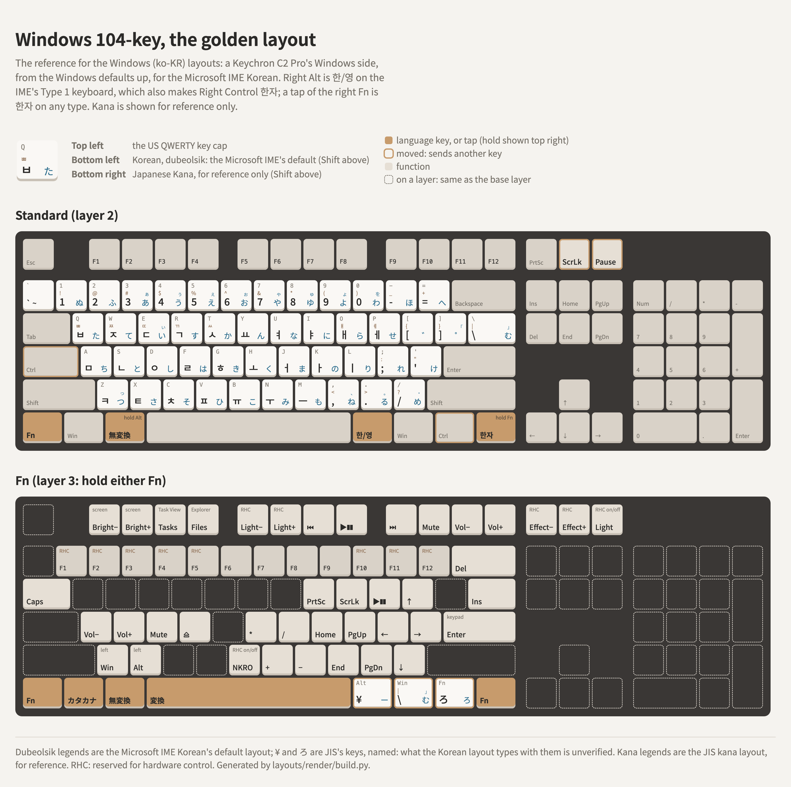

# The golden layout for Windows (ko-KR), on a full-size board

**In progress.** The reference layout for [`layouts-windows-ko-kr/`](../PRINCIPLES.md), designed
from the Windows defaults up, for Windows with the Microsoft IME Korean.

<picture>
  <source media="(prefers-color-scheme: dark)" srcset="layout-dark.png">
  
</picture>

Reference board: **Keychron C2 Pro** (ANSI, RGB, USB `3434:0520`), stock firmware, VIA protocol 11,
edited with [viahid](../../via/raw-hid-keymap-editing/README.md). The board has four layers and a
Mac / Windows switch: layers 0 and 1 are the Mac side, layers 2 and 3 the Windows side. **This
layout is layers 2 and 3, so set the switch to Windows.** The Mac side isn't part of it: it holds
the macOS [us-ansi-104-key-to-jis-with-lt](../../layouts/us-ansi-104-key-to-jis-with-lt/README.md)
layout.

The complete keymap, all four layers, is [keychron-c2-pro.layout.json](keychron-c2-pro.layout.json),
in VIA's saved-layout format, keys in matrix order (6 × 20). Keychron's own keycodes are written as
hex, because their numbers in this firmware (from 0x7F00) don't match VIA's `CUSTOM(n)`: 0x7F07 /
0x7F08 are Task View / File Explorer, 0x7F09 Screenshot, 0x7F0A Cortana, and 0x7F00–0x7F05 the Mac
side's Mission Control, Launchpad, ⌥ and ⌘.

## Starting point

Keychron's Windows keymap, read from the board and identical to `WIN_BASE` / `WIN_FN` in QMK's
`keyboards/keychron/c2_pro/ansi/rgb/keymaps/default/keymap.c`: a standard 104-key layout, with
the Fn layer giving brightness, Task View, File Explorer, backlight and media keys on F1–F12, and
backlight and NKRO controls on the letters.

## Changes from the starting point

| Layer | Key (row,col) | Was | Now |
|---|---|---|---|
| 2 | Bottom left (5,0) | Left Control | Fn (`MO(3)`) |
| 2 | Caps Lock (3,0) | Caps Lock | Left Control |
| 2 | Left Alt (5,2) | Left Alt | **無変換** on a tap, Alt on a hold (`LALT_T(KC_INT5)`, 0x248B) |
| 2 | Right of Print Screen (0,15) | Cortana (Keychron's 0x7F0A) | Scroll Lock |
| 2 | The light key, top right (0,16) | Backlight effect (`RGB_MOD`) | Pause |
| 2 | Right of right Win (5,12) | Fn (`MO(3)`) | Right Control |
| 2 | Right end (5,13) | Right Control | **한자** on a tap, Fn on a hold (`LT(3,KC_LNG2)`, 0x4391) |
| 3 | Tab (2,0) | Backlight on/off (`RGB_TOG`) | Caps Lock |
| 3 | Q W E R T (2,1–2,5), G (3,5) | Backlight controls | Transparent |
| 3 | A S D F (3,1–3,4) | Backlight controls | Volume down, volume up, mute, eject |
| 3 | N (4,7) | NKRO on/off (`NK_TOGG`) | keypad + (NKRO moves to B) |
| 3 | B (4,6) | Transparent | NKRO on/off |
| 3 | Space (5,6) | Transparent | **変換** (`KC_INT4`) |
| 3 | Left Alt (5,2) | Transparent | **無変換** (`KC_INT5`), as on a tap without Fn |
| 3 | X (4,3) | Transparent | Left Alt |
| 3 | Left Win (5,1) | Transparent | **カタカナ/ひらがな** (`KC_INT2`) |
| 3 | Z (4,2) | Transparent | Left Win |
| 3 | The rest of the HHKB Fn layer | Transparent | See below |

The bottom row is now Fn · Win · Alt/無変換 · Space · Alt · Win · Control · Fn/한자, with Fn at
both ends, and Fn+Space is 変換. The Fn layer's own number on this board is 3, as 0 and 1 belong to the Mac side. The top
right is now Print Screen · Scroll Lock · Pause, as on a stock 104-key board. The backlight is
still turned on and off with Fn+Pause, dimmed and brightened with Fn+F5 / F6, and its effects
are on Fn+Print Screen / Scroll Lock.

## The Fn layer (hold either Fn)

The HHKB US Fn layer, laid out as on the macOS
[us-ansi-104-key-to-jis](../../layouts/us-ansi-104-key-to-jis/README.md), with Play/Pause on P:

| Fn + | Sends |
|---|---|
| 1 … 5 (RHC), 6 … 9, 0 - = (RHC) | F1 … F12 |
| Backspace / `\` | Delete / Insert |
| Tab | Caps Lock |
| Space | **変換** (`KC_INT4`) |
| Left Alt | **無変換** (`KC_INT5`) |
| X | Left Alt, since the left Alt key is 無変換 here |
| Left Win | **カタカナ/ひらがな** (`KC_INT2`) |
| Z | Left Win, since the left Win key is カタカナ here |
| I / O / P | Print Screen / Scroll Lock / Play-Pause |
| [ ; ' / | ↑ ← → ↓ |
| K L , . | Home, Page Up, End, Page Down |
| H J M | keypad * / − |
| Enter | keypad Enter |
| A S D F | volume down, volume up, mute, eject |
| N | keypad + |
| **B** (RHC) | NKRO on/off (Keychron's, moved off N) |
| Right Alt / Right Win / Right Control | **¥** (`KC_INT3`) / **む** (`KC_NUHS`, JIS's ] key) / **ろ** (`KC_INT1`) |
| F1 … F4, F7 … F12 | Keychron's: screen brightness, Task View, File Explorer, media, volume |
| **F5 / F6** (RHC) | backlight brightness down / up |
| **Q** (RHC) | transparent |
| **Print Screen / Scroll Lock** (RHC) | backlight effect back / forward (`RGB_RMOD` / `RGB_MOD`) |
| **Pause** (RHC) | backlight on/off |

RHC: [reserved for hardware control](../PRINCIPLES.md#reserved-for-hardware-control-rhc).

## On Windows

The Microsoft IME Korean's **Type 1** keyboard (`kbd101a.dll`) turns Right Alt into 한/영 and
Right Control into 한자. On the other types, Right Control stays Control, so the drawing labels it
Control, and 한자 is the tap of the right Fn. Check which type the machine uses first: see
[the principles](../PRINCIPLES.md#general-tips).

A tap of the right Fn sends USB LANG2, which Windows reads as 한자 (`VK_HANJA`) on every keyboard
type, so 한자 doesn't depend on Type 1. The tap vs hold timing is QMK's default, and hasn't been
tried in real use on this board yet.

## Why this works with Japanese Kana

A guaranteed one-tap switch to Japanese Kana while using a Korean IME takes extensive macros, or a
custom all-in-one IME such as [FKeyIME](https://github.com/themrsung/fkeyime) (in early
development as of 2026-10-24). Without one, you switch between the two pairs, English + Korean
(the Microsoft IME Korean) and English + Japanese (the Microsoft IME Japanese), often, with
Win+Space or a mouse click on the language bar.

This layout respects the first pair, with 한/영 and 한자 where the Korean IME expects them, and lets
the second work properly by giving every JIS kana key a key of its own: the three a US board lacks
are on Fn + the keys right of Space, ー on ¥, む and ろ. JIS's 無変換 and 変換, either side of
Space on a JIS board, are a tap of the left Alt and Fn+Space, and カタカナ/ひらがな is Fn + the
left Win.

On the Korean side *(tested on Windows with the Microsoft IME Korean)*, 無変換 and 変換 do
nothing, and カタカナ/ひらがな commits the syllable in composition, with no other side effects.
The Korean layout (`kbd101a.dll`) gives 変換 and カタカナ/ひらがな no VK, and 無変換 VK 0xEB
(`MapVirtualKeyEx`).

**Not tested yet:** whether the Microsoft IME Japanese's modes (kana and romaji input) can be
switched with the keys this layout already has.

## Testing on a Mac

[windows-tester](../../utils/windows-tester/README.md) shows each key and combination as Windows
would receive it, and simulates the Microsoft IME Korean, so the layout can be tried without a
Windows machine. It's a simulation: confirm on Windows before calling something done.

## Author's notes

This finally got me typing on a text editor manually instead of prompting Claude. Why is
Japanese かな input so bad on Windows??? I will complete [fkeyime](https://github.com/themrsung/fkeyime) soon.

First of all, it needs three lang keys to work properly, its predictions are terrible,
and hankaku/zenkaku is **「transient」**！！！
