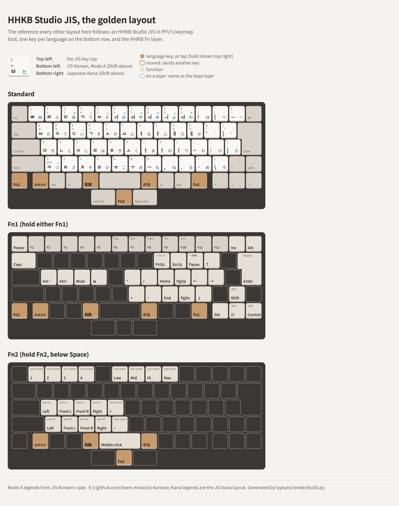
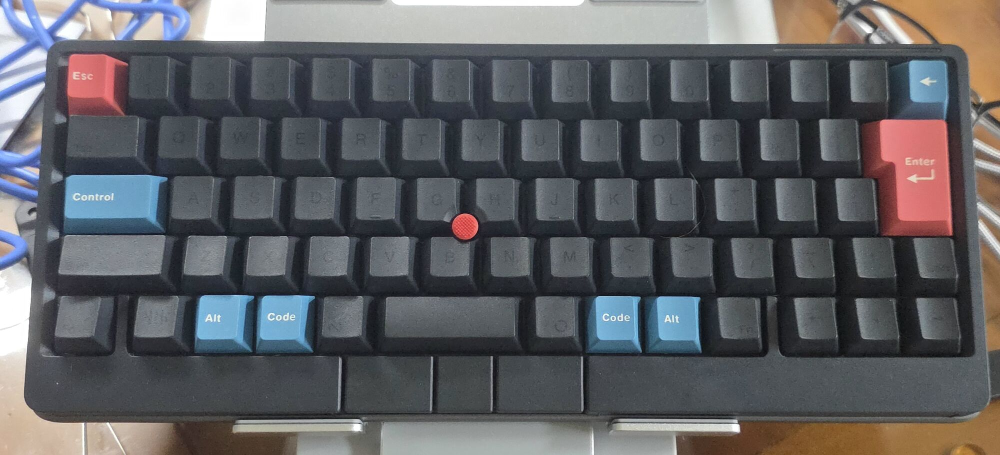

# The golden layout: HHKB Studio JIS

The reference every other layout here follows ([PRINCIPLES.md](../PRINCIPLES.md), 3). It's a stock
HHKB Studio JIS with a new bottom row, set up entirely in PFU's HHKB Studio Keymap Tool: one key per
language (カタカナ, 英数, かな), the HHKB Fn layer on Fn1, and the pointing stick and gesture pads
on Fn2.

<picture>
  <source media="(prefers-color-scheme: dark)" srcset="layout-dark.png">
  
</picture>

The owner's board, for reference, with an aftermarket keycap set: **Alt** is ⌥ Option and
**Code** is ⌘ Command.



The keymap is [hhkb-studio-golden.hks](hhkb-studio-golden.hks), an export from the HHKB Studio
Keymap Tool, in **Profile1**; the drawing is [layout.html](layout.html). Pick **Profile1** in the
tool's drop-down, open the file and write it to the keyboard. The tool takes only the picked
profile from the file and leaves the other three as they were (found on 2026-10-26; the source
below says importing replaces all profiles, which isn't so). Export your own first anyway.
Profiles 2–4 are copied unchanged from the source below (PFU's
Mac default, and two Windows keymaps). Profile2 isn't quite the factory file's: on the Fn1, Fn2
and Fn3 layers, 174 keys that a factory-reset export
([utils/hhkb-studio-profiles](../../utils/hhkb-studio-profiles/README.md)) lists with their
Standard code are 1 here. 1 looks like "as on Standard", which would make the two the same, but
that hasn't been tested.

## Source, and what changed

Based on the owner's Profile1 in
[hhkb-ekj-trilingual](https://github.com/themrsung/hhkb-ekj-trilingual), in
[`docs/07-hhkb-studio.md`](https://github.com/themrsung/hhkb-ekj-trilingual/blob/main/docs/07-hhkb-studio.md)
and [`docs/hhkb-studio-setting-all.hks`](https://github.com/themrsung/hhkb-ekj-trilingual/blob/main/docs/hhkb-studio-setting-all.hks),
with two changes:

| | Source | Golden |
|---|---|---|
| The key in the 半/全 position (`KeyJISKLangKorean`), on all four layers | F18 (code 109, 0x6D) | **カタカナ** (code 136, 0x88: the Windows JIS カタカナ/ひらがな key) |
| Gesture pads (left side, front left, front right, right side) | off, off, on, on | **all off** |

Nothing else in the file differs from the source. Checked on 2026-10-24: the file loads in the
HHKB Studio Keymap Tool (1.1.2), and its keymap, pointing-stick and gesture-pad settings are the same
as an export from the owner's board. The only difference is DIP switch 6, which is physical and on
on the owner's board (power saving off).

## Standard

Stock JIS except the bottom row:

```
Fn1 | カタカナ | Opt | ⌘ | 英数 | Space | かな | ⌘ | Opt | Fn1 | ← | ↓ | →
                    LB | Fn2 | RB        (pointing-stick buttons, below Space)
```

In canonical names, left to right: `KeyHHKBLeftFunction`, `KeyJISKLangKorean`, `KeyLeftAuxiliary`,
`KeyLeftPrimary`, `KeyJISMacEnglish`, `KeySpacebar`, `KeyJISMacKana`, `KeyRightPrimary`,
`KeyRightAuxiliary`, `KeyHHKBRightFunction`, `KeyLeftArrow`, `KeyDownArrow`, `KeyRightArrow`; below
Space, `KeyLeftMouseButton`, `KeyHHKBFunctionTwo`, `KeyRightMouseButton`. Other names:
[Key names](../README.md#key-names).

- **カタカナ** goes to Korean in [JIS Korean](https://github.com/team-mirae/jis-korean), **英数** to
  English, **かな** to Japanese. macOS discards カタカナ by itself; JIS Korean reads it at the HID
  level ([katakana-lost-by-macos](../../macos-input-method/katakana-lost-by-macos/README.md)).
- Control is left of A, ↑ is in the Shift row left of the right Shift, ¥ and ろ are where JIS has
  them.

## Fn1 (hold either Fn1)

The HHKB Fn layer: F1–F12 on the number row, Insert / Delete on ¥ / BS, Caps Lock on Tab, the
arrows and Home / End / Page keys on the right, volume and eject on A–F, keypad keys on H J N M and
Enter, Power on Esc. Studio extras: the arrow cluster gives Delete, right ⌘ and right Control, and ↑
gives right Shift.

Fn1+I and Fn1+P send Print Screen and Pause. With the Karabiner-Elements rules from
hhkb-ekj-trilingual they become ⌘⇧4 and Play/Pause; without them macOS sees F13 and F15.

## Fn2 (hold Fn2, below Space)

| Fn2 + | Canonical name | Does |
|---|---|---|
| 1 / 2 / 3 / 4, G / B | `KeyOne` … `KeyFour`, `KeyG` / `KeyB` | Pointing-stick speed 1–4, faster / slower |
| 6 / 7 / 8 / 9 | `KeySix` … `KeyNine` | Gesture-pad speed: low, mid, high, max |
| A / S / D / F | `KeyA` / `KeyS` / `KeyD` / `KeyF` | Turn on the left-side, front-left, front-right, right-side pad |
| Z / X / C / V | `KeyZ` / `KeyX` / `KeyC` / `KeyV` | Turn the same pads off |
| Space | `KeySpacebar` | Middle click (`KeyMiddleMouseButton`) |

The pads start off, so touching the case's edges does nothing until a pad is turned on.

## Fn3

Unused: the same as Standard, except that the カタカナ key is set on it too. Not drawn.

## Settings outside the keymap

DIP switches all off (the file records them, but they're physical switches: set them by hand);
pointing-stick buttons on (LB / Fn2 / RB); gesture pads all off. See the
source for what the DIP switches do on the Studio and for Bluetooth pairing.
