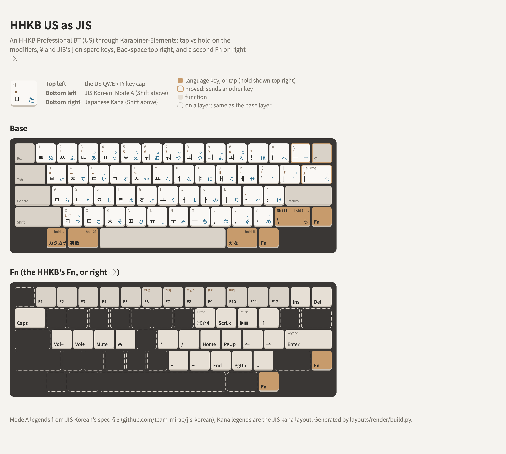

# An HHKB Professional BT (US) with JIS's keys, through Karabiner

The HHKB Professional BT can't be remapped beyond its DIP switches, so Karabiner-Elements adds JIS's
keys: tap vs hold on the modifiers, ¥ and JIS's ] on keys the HHKB has to spare, Backspace where an
HHKB JIS has it, and a second Fn on right ◇.

<picture>
  <source media="(prefers-color-scheme: dark)" srcset="layout-dark.png">
  
</picture>

The rules are [hhkb-pro-bt-as-jis.json](hhkb-pro-bt-as-jis.json) (for vendor 1278, product 514
only); the drawing is [layout.html](layout.html). Full guide:
[docs/legacy-hhkb-us-as-jis](https://github.com/team-mirae/jis-korean/tree/main/docs/legacy-hhkb-us-as-jis)
in JIS Korean.

| HHKB key | Canonical name | Tap | Hold |
|---|---|---|---|
| Left ◇ (⌥) | `KeyLeftAuxiliary` | カタカナ | ⌥ |
| Left ◆ (⌘) | `KeyLeftPrimary` | 英数 | ⌘ |
| Right ◆ (⌘) | `KeyRightPrimary` | かな | ⌘ |
| Right ◇ (⌥) | `KeyRightAuxiliary` | | Fn, a second one (`KeyVirtualFunction`) |
| Right Shift | `KeyRightShift` | ろ | Shift |
| `\` | `KeyUSBackslash` | ¥ | |
| Delete | `KeyDeleteLeft` | JIS ] (む in Kana) | |
| `` ` `` | `KeyUSGrave` | Backspace (Fn+`` ` `` stays forward Delete) | |

Other names: [Key names](../README.md#key-names). The HHKB's own Fn is `KeyHHKBUSFunction`.

- **DIP switches:** SW1 off, SW2 on (Mac mode), SW6 on (wake up), the rest off.
- **Karabiner's virtual keyboard stored as JIS** (`593-1452-0` = 42), and Modify events on for the
  HHKB.
- **Rule order matters:** the Fn rule goes above the others, or Fn+`` ` `` and Fn+`\` type
  Backspace and ¥.
- **Two versions of the Fn rule:** standard (Print Screen, Pause on I, P) and Mac extras (⌘⇧4,
  Play/Pause). One of the two swap rules: JIS ] on Delete with Backspace on `` ` `` (recommended),
  or JIS ] on `` ` `` keeping Delete as Backspace, for long-time HHKB US typists.

Why the second Fn has to rebuild the whole layer: [fn-layer-is-firmware-only](../../hhkb/fn-layer-is-firmware-only/README.md).

Tested with Japanese Kana: むろん → 無論, むろまち → 室町, こころ → 心, ろく → 六, ろーま → ローマ, ろーぷ →
ロープ, むーど → ムード. A good way to try kana typing on an HHKB US before deciding on an HHKB JIS.
