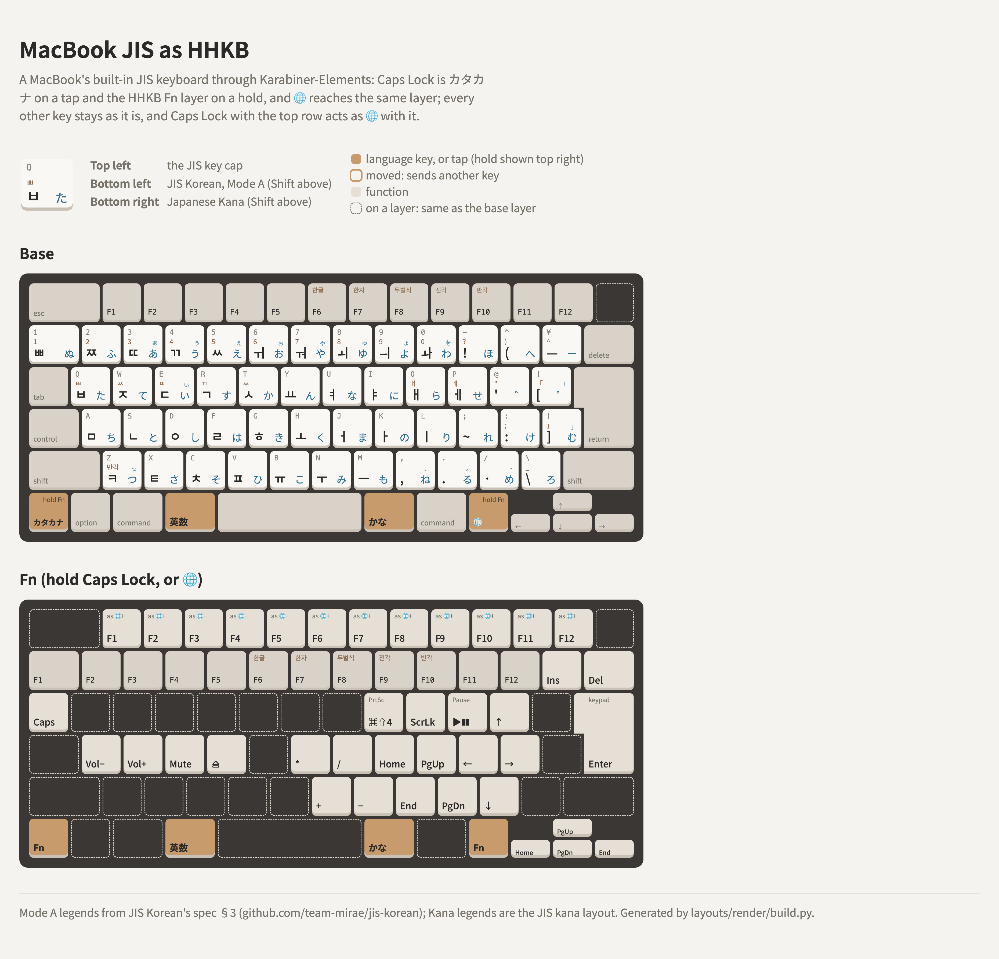

# A MacBook's built-in JIS keyboard with the HHKB Fn layer, through Karabiner

A MacBook JIS already has 英数, かな, ¥ and ろ, so Karabiner-Elements only adds two things: カタカナ on
a tap of Caps Lock, and the HHKB Fn layer on a hold of Caps Lock or 🌐. Nothing is given up: Caps
Lock moves to Fn+Tab, as on an HHKB, and every 🌐 chord the HHKB layer doesn't use still reaches
macOS.

<picture>
  <source media="(prefers-color-scheme: dark)" srcset="layout-dark.png">
  
</picture>

The rules are [macbook-jis-as-hhkb.json](macbook-jis-as-hhkb.json) (built-in keyboard only); the
drawing is [layout.html](layout.html).

| Key | Canonical name | Tap | Hold |
|---|---|---|---|
| Caps Lock | `KeyCapsLock` | カタカナ (to Korean) | Fn layer (`KeyVirtualFunction`) |
| fn (🌐) | `KeyMACGlobe` | 🌐 as usual | Fn layer, for the keys it defines; any other 🌐 chord as usual |
| 英数, かな | `KeyJISMacEnglish`, `KeyJISMacKana` | as printed | |

Other names: [Key names](../README.md#key-names).

## The Fn layer

The HHKB one, with the Mac extras, laid onto the JIS keys by position:

- **Number row:** F1–F10 on 1–0, F11 on -, F12 on ^, Insert on ¥, forward Delete on delete.
- **Tab:** Caps Lock.
- **I:** ⌘⇧4 (screenshot of a selection). **O:** Scroll Lock. **P:** Play/Pause.
- **Arrows:** ↑ on @, ← on ;, → on :, ↓ on /.
- **K / L / , / .:** Home, Page Up, End, Page Down.
- **H / J / N / M:** keypad *, /, + and −. **return:** keypad Enter.
- **A / S / D / F:** volume down, volume up, mute, eject.
- **The arrow keys:** Home, End, Page Up and Page Down, as fn does on any Mac.
- **The top row:** F1–F12 with fn added, so Caps Lock with an F-key does whatever 🌐 with it does.

**🌐 with the top row is left to macOS,** and so are F1–F12, esc and Touch ID on their own: the
media keys and 🌐+F-keys work as they always have.

## 🌐 as a second Fn

🌐 isn't remapped. Each layer key has a second rule that needs fn as a modifier, so a 🌐 chord the
layer defines fires the HHKB shortcut, and anything else (🌐 alone, 🌐+E for emoji, 🌐+Q, 🌐+C, the
top row) goes to macOS as usual. 🌐+arrows and 🌐+delete are left to macOS, which already gives
them the same meaning.

The macOS 🌐 shortcuts on keys the HHKB layer uses are lost: 🌐+F (full screen), 🌐+A (Dock), 🌐+D
(dictation), 🌐+H (desktop), 🌐+N (Notification Center) and 🌐+M (menu bar). The 🌐 rules are a
Karabiner rule of their own ([🌐]), so if you need those back, leave it off and use Caps Lock for
the layer.

## The keyboard type

The built-in keyboard is JIS already. While Karabiner modifies it, its keys reach macOS through
Karabiner's virtual keyboard, which must be stored as JIS too (`593-1452-0` = 42), or ¥ and ろ are
dropped: see the [README](../../README.md).
