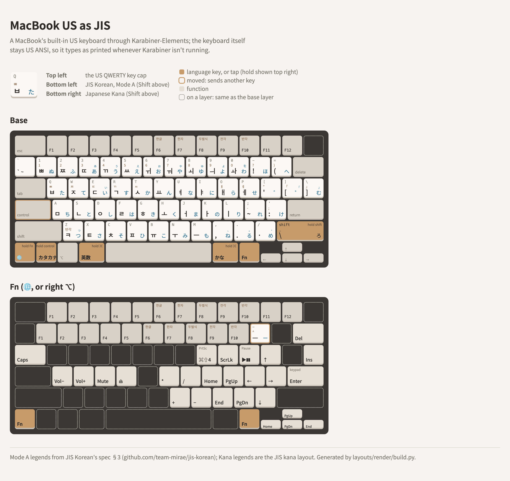

# A MacBook's built-in US keyboard with JIS's keys, through Karabiner

Karabiner-Elements gives a MacBook's US keyboard JIS's language keys and ろ as tap vs hold, ¥ on a Fn
layer, and a second Fn on right ⌥, while the keyboard itself stays US ANSI, so it types as printed
whenever Karabiner isn't running (a password before login, or Karabiner failing).

<picture>
  <source media="(prefers-color-scheme: dark)" srcset="layout-dark.png">
  
</picture>

The rules are [macbook-us-as-jis.json](macbook-us-as-jis.json) (built-in keyboard only); the
drawing is [layout.html](layout.html). Full guide:
[docs/macbook-us-as-jis](https://github.com/team-mirae/jis-korean/tree/main/docs/macbook-us-as-jis)
in JIS Korean.

| Key | Tap | Hold |
|---|---|---|
| Left Control | カタカナ | Control |
| Left ⌘ | 英数 | ⌘ |
| Right ⌘ | かな | ⌘ |
| Right Shift | ろ | Shift |
| Caps Lock | Control | Control |
| fn (🌐) | 🌐 as usual | Fn layer |
| Right ⌥ | | Fn layer |

The Fn layer is the HHKB US one with the Mac extras, plus what fn does on any Mac (forward Delete,
Home/End/Page keys on the arrows, F1–F12 on the top row), with **¥ on fn+`-`** in place of F11 and
nothing on `=`. `` ` `` is left alone. JIS's ] (む) is the US `\` key by position.

## The keyboard type

The built-in keyboard can't be stored as JIS from the command line: it reports vendor 0, product 0
and `KeyboardLanguage` "U.S.", and has no entry in `com.apple.keyboardtype`. That's fine: while
Karabiner modifies it, its keys reach macOS through Karabiner's virtual keyboard, stored as JIS
(`593-1452-0` = 42), and without Karabiner it's the US keyboard printed on the caps.

The layer takes fn over, so 🌐 + letter shortcuts (🌐E emoji, 🌐F full screen) no longer reach macOS;
a tap of 🌐 alone still works.
