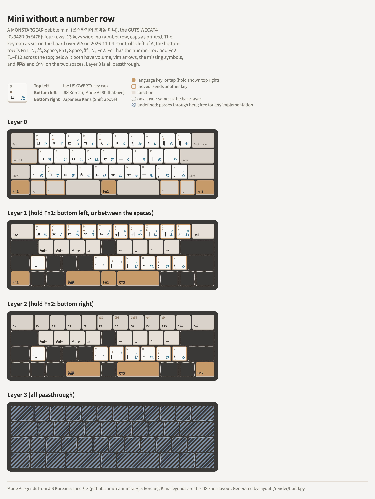

# A mini without a number row

The keymap of a MONSTARGEAR pebble mini (몬스타기어 조약돌 미니), as it is on the board: four rows,
13 keys wide, no number row, with the caps as printed.

<picture>
  <source media="(prefers-color-scheme: dark)" srcset="layout-dark.png">
  
</picture>

Reference board: **GUTS WECAT4** (the name it reports; manufacturer "Hangsheng"), stock firmware,
over USB (`0x342D:0xE47E`), VIA protocol 12, 4 layers, a 4 × 12 matrix. Read and set over VIA's
protocol with [viahid](../../via/raw-hid-keymap-editing/README.md) on 2026-11-04;
[wecat4-keymap.txt](wecat4-keymap.txt) is every layer, and writes it back:

```sh
grep -v '^#' layouts/mini-numberless/wecat4-keymap.txt | xargs ./viahid --vid 0x342D --pid 0xE47E set
```

The bottom row's matrix positions are from the board's VIA definition
([typing-robot's boards/gats-wecat4](../../utils/typing-robot/boards/gats-wecat4/)): `3,0` `3,1` `3,2`
`3,4` `3,5` `3,7` `3,9` `3,10` `3,11`, left to right.

## Layer 0

| Key | Canonical name | Sends |
|---|---|---|
| Caps Lock cap | `KeyLeftControl` | Left Control (`KC_LCTL`) |
| / left of Z | `KeyUSSlash` | / |
| Bottom row, left to right | | **Fn1** (`MO(1)`), ⌥ (`KC_LALT`), ⌘ (`KC_LGUI`), Space, **Fn1** (`MO(1)`), Space, ⌘ (`KC_RGUI`), ⌥ (`KC_RALT`), **Fn2** (`MO(2)`) |

Every other key sends what's printed on it. There's no ; or ' in the base layer: they're on Fn1.

## Layer 1 (Fn1: bottom left, or the key between the spaces)

| Fn1 + | Sends |
|---|---|
| Tab · Q … P · Backspace | Esc · 1 … 0 · Delete (forward) |
| A S D F | Volume down, volume up, mute, eject |
| H J K L | ← ↓ ↑ → |
| / | `` ` `` (`KC_GRV`) |
| V B N M , . | `[` `]` `\` `;` `'` (US codes 0x2F–0x34) and ろ (`KC_INT1`) |
| Left Space · right Space | 英数 (`KC_LNG2`) · かな (`KC_LNG1`) |

The rest pass through (`KC_TRNS`). The spaces were 変換 (`KC_INT4`) and カタカナ (`KC_INT2`) from the
factory: macOS drops 変換 and turns カタカナ into かな
([japanese-keycodes-on-macos](../../qmk/japanese-keycodes-on-macos/README.md)), so they're now the
Mac's own 英数 and かな.

## Layer 2 (Fn2: bottom right)

Tab, Q … P and Backspace are F1 … F12. Below the top row, Fn2 is the same as Fn1: volume, arrows,
symbols, 英数 and かな, so they work with either Fn held. Keys that are passthrough on Fn1 are
passthrough here too.

## Layer 3

All passthrough (`KC_TRNS`), wiped 2026-11-04. Nothing in layers 0–2 switches to it. Before the
wipe it held a number row, arrows, RGB lighting keys (0x7820–0x782A), vendor keys (0x7E00–0x7E58)
and 0x7C03:

```
0029 001E 001F 0020 0021 0022 0023 0024 0025 0026 0027 7E07
0001 7E00 7E01 7E02 7E05 7825 7827 7826 002D 002E 0000 7820
0001 0035 7821 782A 7829 0001 7824 7828 7823 0001 0052 7E57
7C03 0001 0001 0000 0001 0001 0000 7E58 0000 0050 0051 004F
```
