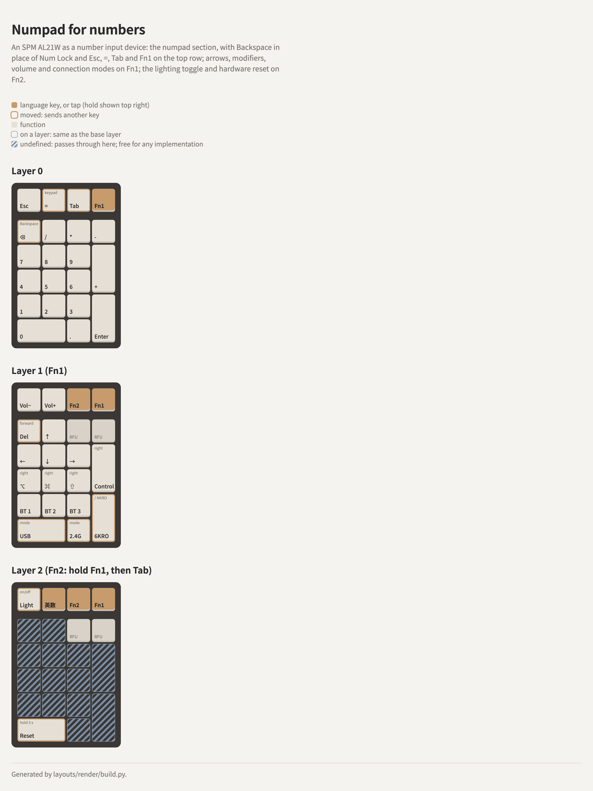

# A numpad for numbers

A numpad set up as a number input device, not a whole keyboard: the numpad section as it is, minus
Num Lock, with Backspace, Esc, = and Tab on the keys that frees, and the lighting toggle and the
hardware reset on a second Fn layer, out of the way.

<picture>
  <source media="(prefers-color-scheme: dark)" srcset="layout-dark.png">
  
</picture>

Reference board: **SPM AL21W**, stock firmware, over USB (`0x36B0:0x311A`), remapped over VIA's
protocol. Start from the factory keymap
([al21w-factory-reset](../../spm-works/al21w-factory-reset/README.md)), then apply
[al21w-numpad-numbers.txt](al21w-numpad-numbers.txt), the changes from it, with
[viahid](../../via/raw-hid-keymap-editing/README.md):

```sh
grep -v '^#' layouts/numpad-numbers/al21w-numpad-numbers.txt | xargs ./viahid --vid 0x36B0 --pid 0x311A set
```

## Layer 0

| Key | Factory | Here |
|---|---|---|
| Top row, 1st | Esc | Esc |
| Top row, 2nd | Calculator | **=** (keypad =, `KC_PEQL`, 0x67) |
| Top row, 3rd | Backspace | **Tab** |
| Top row, 4th | Fn (`MO(1)`) | Fn1 (`MO(1)`) |
| Num Lock | Num Lock | **Backspace** |
| The numpad section | / * − + Enter, 0–9, . | unchanged |

Layer 3 gets the same keys, without Fn1, as it has in the factory keymap. Nothing switches to it
that we know of.

## Layer 1 (Fn1)

SPM's factory Fn layer, trimmed:

| Fn1 + | Factory | Here |
|---|---|---|
| Tab (top row, 3rd) | nothing | **Fn2** (`MO(2)`) |
| Backspace (the Num Lock key) | Lighting on/off | **Delete (forward)**, as on the other layouts |
| / · 8 · 9 | Lighting hue −, effect speed −, effect speed + | **↑ · ↓ · →** |
| 5 · 6 | Lighting saturation −, + | **Right ⌘ · right Shift** |
| + | Lighting brightness + | **Right Control** |
| * − | Lighting hue +, brightness − | **Nothing** (`KC_NO`): reserved for future use (RFU) |
| Enter | Next lighting effect | **6-key / full rollover** (`CUSTOM(7)`), moved from 7 |
| Esc | Sleep | **Volume down** |
| = | Tab | **Volume up** (Tab has its own key) |
| 7 | 6-key / full rollover | **←** (rollover moved to Fn1 + Enter) |
| 1 2 3 | Bluetooth 1–3 | unchanged |
| 4 | 2.4 GHz mode | **Right Option** (2.4 GHz moved to Fn1 + .) |
| 0 | Hardware reset (hold about 3 seconds) | **USB mode** (SPM's `USB`, `CUSTOM(4)`); the reset moved to Fn2 + 0 |
| . | . | **2.4 GHz mode** (`CUSTOM(0)`) |

Dropped keys are transparent (`KC_TRNS`), not dead: a number typed with Fn1 still held comes out
as a number.

## Layer 2 (Fn2: hold Fn1, then Tab)

Momentary layers stack: holding Fn1 turns on layer 1, where Tab is `MO(2)`, and holding it too
turns on layer 2 (checked on the board, 2026-10-24).

| Fn2 + | Sends |
|---|---|
| Esc | **Lighting on/off** (SPM's `RTOG`, `CUSTOM(11)`), moved from Fn + Num Lock |
| = | **英数** (`KC_LNG2`): back to English input |
| 0 | **Hardware reset** (hold about 3 seconds), moved from Fn + 0 |
| * − | **Nothing** (`KC_NO`): reserved for future use (RFU), as on Fn1 |

The reset takes Fn1 + Tab + 0 held together.

**The rest of layer 2 is deliberately undefined** (hatched in the drawing). Here it passes through
(`KC_TRNS`), and any implementation of this layout may put whatever it likes there.

## Choices

- **Num Lock is redundant on macOS**, where the keypad always types digits; its key is the
  nearest one free for Backspace.
- **Esc covers Clear.** On an Apple keypad that key is Clear; Esc clears in Calculator and most
  number fields, so nothing is lost (principle 2).
- **= where an Apple keypad has it**, in the second column above /, and as the keypad's own =
  (principle 3). Keypad = rather than the main = (`KC_EQL`): apps that don't care treat it as =
  (Excel starts a formula with it, checked 2026-10-24), and apps that do can bind it on its own.
- **Tab next to it**, so a table, form or spreadsheet fills from the numpad alone: Enter moves
  down, Tab moves right.
- **Delete on Fn1 + Backspace**, as on the HHKB Fn layer every other layout uses (principle 3).
- **Only the lighting toggle is kept, on Fn2 + Esc:** set the lighting once and leave it. The
  toggle stays a toggle, as principle 1 allows: whether the lighting is on is a binary state the
  user perceives right where the key is pressed (its exception 3), and there are too few keys for separate on and
  off anyway (exception 1).
  Tapping Fn2 for it isn't possible: a layer-tap's tap is an 8-bit basic keycode, and the toggle
  is SPM's vendor keycode 0x7E0B. VIA's Lighting menu
  (from SPM's definition) still sets brightness, effect, speed and colour. The hardware reset
  (Fn2 + 0, held) also puts the lighting back to its default, but it resets the keymap too.
- **Connection modes together, bottom left:** Bluetooth 1–3 on 1 2 3, USB on 0 and 2.4 GHz on the
  dot. USB on 0 follows the HHKB, where Fn + Ctrl + 0 picks USB and 1–4 the Bluetooth slots. SPM's
  definition has a USB mode key, though the factory keymap doesn't use it; how it works with the
  slider on the back (USB / Bluetooth / 2.4 GHz) hasn't been tested yet.
- **Arrows as an inverted T on / 7 8 9** (↑ on /, ← ↓ → on 7 8 9), the shape of a keyboard's
  arrow keys.
- **Right Option, right ⌘ and right Shift on Fn1 + 4 5 6, right Control on Fn1 + +**, next to the
  arrows: with Fn1 held, Option or Shift + arrows move by word or select from the numpad alone.
  They're the right-hand codes, so apps and remappers can tell them from the left ones the main
  keyboard sends. These are additions; principle 4 doesn't ask for them on a numpad.
- **Volume down and up on Fn1 + Esc and =, and no mute.** Mute adds a second state to volume
  (is it muted, and at what level?), which goes against principle 1. Play/pause, a tap of Fn1,
  does mute's job better: the content stops, not just its sound, so nothing is missed. The one
  case where mute wins is a live stream followed in real time, and a numpad used as a macropad is
  unlikely to be used that way.
- **\* and − are reserved on Fn1 and Fn2** (RFU), and send nothing rather than passing through. The
  chords are hard to reach with one hand, which suits future hardware functions that shouldn't be
  pressed by accident.
- **Sleep is dropped** as redundant.
- **Rollover on Fn1 + Enter**, next to the connection keys: the board's settings all sit in the
  bottom right and bottom left of Fn1.
- **英数 on Fn2 + =**, a quick way back to English input, for passwords and fields that don't take
  an input method: useful when the main keyboard is too small for its own 英数 key and switches by
  cycling or toggling, or with more than three input methods to cycle through. It's idempotent
  (principle 1): pressed any number of times, it ends in English. The chord is three neighbouring
  keys, Fn1, Tab and =, pressed by three fingers from right to left. Where 英数 lands depends on
  the input sources enabled ([eisu-selects-abc](../../macos-input-method/eisu-selects-abc/README.md)).
- **The hardware reset moves to Fn2 + 0.** On a numpad, Fn + 0 is an easy chord to hit, and it
  wipes the keymap; three keys held for three seconds aren't hit by accident.
- **Fn2 on Fn1 + Tab:** the top row has no free key left for a second Fn, and Tab is next to Fn1,
  so both are held with one hand.
- **Calculator is dropped:** it opens an app rather than typing a number.
- **No Control, Option or ⌘:** a numpad isn't a keyboard, so principle 4's modifier rule doesn't
  apply ([PRINCIPLES.md](../PRINCIPLES.md)).
