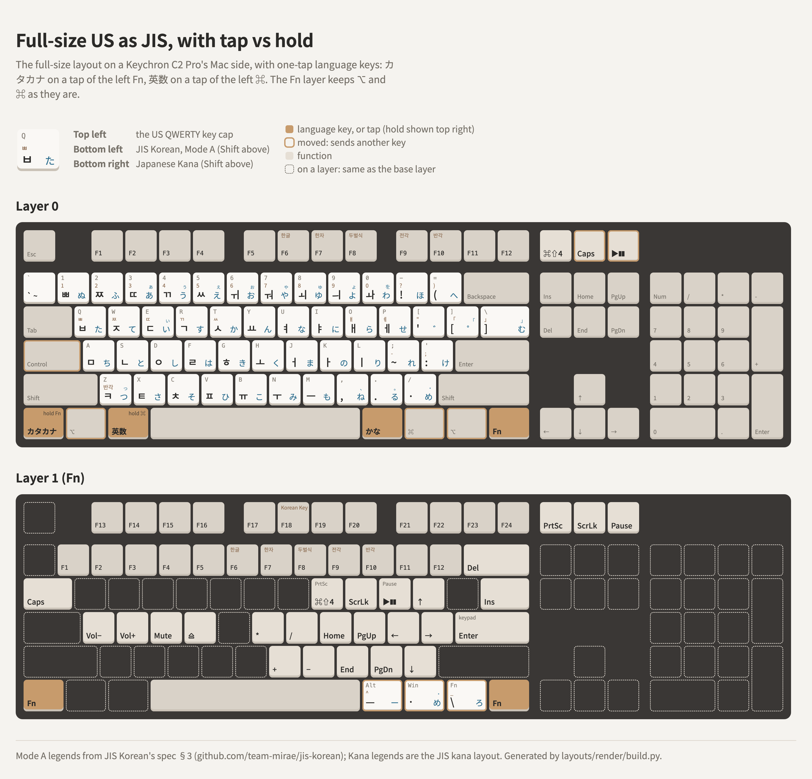

# A full-size US keyboard with JIS's keys, with tap vs hold

[us-ansi-104-key-to-jis](../us-ansi-104-key-to-jis/README.md) with one-tap language keys: a tap of
the left Fn is **カタカナ** and a tap of the left ⌘ is **英数**, while holding them is still Fn and
⌘. With the language keys on the taps, the Fn layer gives the bottom-row modifiers back: Fn + ⌥ /
⌘ are ⌥ and ⌘ again, so Fn+Z / X type Z and X. Everything else is the same. It needs a firmware
whose mod-tap works, so it isn't for the Magnetox XF
([hansung/mod-tap-rshift-bug](../../hansung/mod-tap-rshift-bug/README.md)).

<picture>
  <source media="(prefers-color-scheme: dark)" srcset="layout-dark.png">
  
</picture>

Reference board: **Keychron C2 Pro** (ANSI, RGB, USB `3434:0520`), stock firmware, VIA protocol
11, edited with [viahid](../../via/raw-hid-keymap-editing/README.md). This layout is the Mac side
of its Mac / Windows switch (layers 0 and 1); the Windows side is
[windows-104-key-golden](../../layouts-windows-ko-kr/windows-104-key-golden/README.md). The
complete keymap, all four layers, is [keychron-c2-pro.layout.json](keychron-c2-pro.layout.json),
in VIA's saved-layout format, keys in matrix order (6 × 20). Layers 0 and 1 were copied key by key
from the Magnetox XF's, then changed as below.

## Layer 0

Unchanged from a US board except:

| Key | Canonical name | Sends |
|---|---|---|
| Bottom row | `KeyUSLeftControl` · `KeyLeftPrimary` · `KeyLeftAuxiliary` · `KeySpacebar` · `KeyRightAuxiliary` · `KeyRightPrimary` · `KeyMomentaryNextLayer` (the Fn cap) · `KeyRightControl` | **カタカナ** / Fn (`LT(1,KC_INT2)`) · ⌥ · **英数** / ⌘ (`LGUI_T(KC_LNG2)`) · Space · かな (`KC_LNG1`) · ⌘ · ⌥ · `MO(1)` |
| Caps Lock | `KeyCapsLock` | Control (HHKB-style) |
| Print Screen | `KeyPrintScreen` | ⌘⇧4 (`LSG(KC_4)`) |
| Scroll Lock / Pause | `KeyWINCortana` / `KeyKeyboardHardwareControl` (the Cortana and light caps) | Caps Lock / Play-Pause (the C2 Pro's Cortana and light keys) |

Other names: [Key names](../README.md#key-names).

## Layer 1 (Fn: hold either Fn)

| Fn + | Canonical name | Sends |
|---|---|---|
| Left ⌥ / left ⌘ | `KeyLeftPrimary` / `KeyLeftAuxiliary` (the Win and Alt caps) | ⌥ / ⌘ (transparent): the language keys are on the taps |
| The 3 keys right of Space | `KeyRightAuxiliary` · `KeyRightPrimary` · `KeyMomentaryNextLayer` (the Fn cap) | **¥** (`KC_INT3`) · / · **ろ** (`KC_INT1`), as on the 87-key layout |
| F1 … F12 | `KeyFunctionOne` … `KeyFunctionTwelve` | F13 … F24 (Fn+F6 = F18) |
| 1 … 0, -, = | `KeyOne` … `KeyZero`, `KeyUSMinus`, `KeyUSEquals` | F1 … F12 |
| Backspace / `\` | `KeyDeleteLeft` / `KeyUSBackslash` | Delete / Insert |
| Tab | `KeyTab` | Caps Lock |
| I / O / P | `KeyI` / `KeyO` / `KeyP` | ⌘⇧4 / Scroll Lock / Play-Pause |
| [ ; ' / | `KeyUSLeftBracket` `KeyUSSemicolon` `KeyUSApostrophe` `KeyUSSlash` | ↑ ← → ↓ |
| K L , . | `KeyK` `KeyL` `KeyUSComma` `KeyUSPeriod` | Home, Page Up, End, Page Down |
| H J N M | `KeyH` `KeyJ` `KeyN` `KeyM` | keypad * / + − |
| Enter | `KeyUSEnter` | keypad Enter |
| A S D F | `KeyA` `KeyS` `KeyD` `KeyF` | volume down, volume up, mute, eject |
| Print Screen cluster | `KeyPrintScreen` `KeyScrollLock` `KeyPause` | Print Screen, Scroll Lock, Pause |

The Fn layer from 1 down is the HHKB US Fn layer, with the Mac extras (⌘⇧4 on I, Play/Pause on P).

## On the Mac

Store the keyboard as **JIS** in Keyboard Setup Assistant: press Z for the key right of the left
Shift, then Fn + the third key right of Space (ろ) for the key left of the right Shift. Then ¥ and
ろ type, and the board's US caps type JIS's keys by position: `[` `]` `\` are JIS's @ [ ], `=` is ^,
`'` is :.

## Choices

- **The taps replace Fn + ⌥ / ⌘, not add to them.** That gives the Fn layer its modifiers back
  and frees Z and X, but each language key now has one way in: if tap vs hold misfires, for example
  on a fast ⌘ shortcut, there's no second key for カタカナ or 英数
  ([several points of access](../PRINCIPLES.md#5-several-points-of-access)).
- **Tap vs hold timing is QMK's default,** and not yet tried in real use on this board.
- Only plain `KC_LNG2` gives 英数 on a Mac; 変換, 無変換 and LANG3–5 don't
  ([japanese-keycodes-on-macos](../../qmk/japanese-keycodes-on-macos/README.md)).
