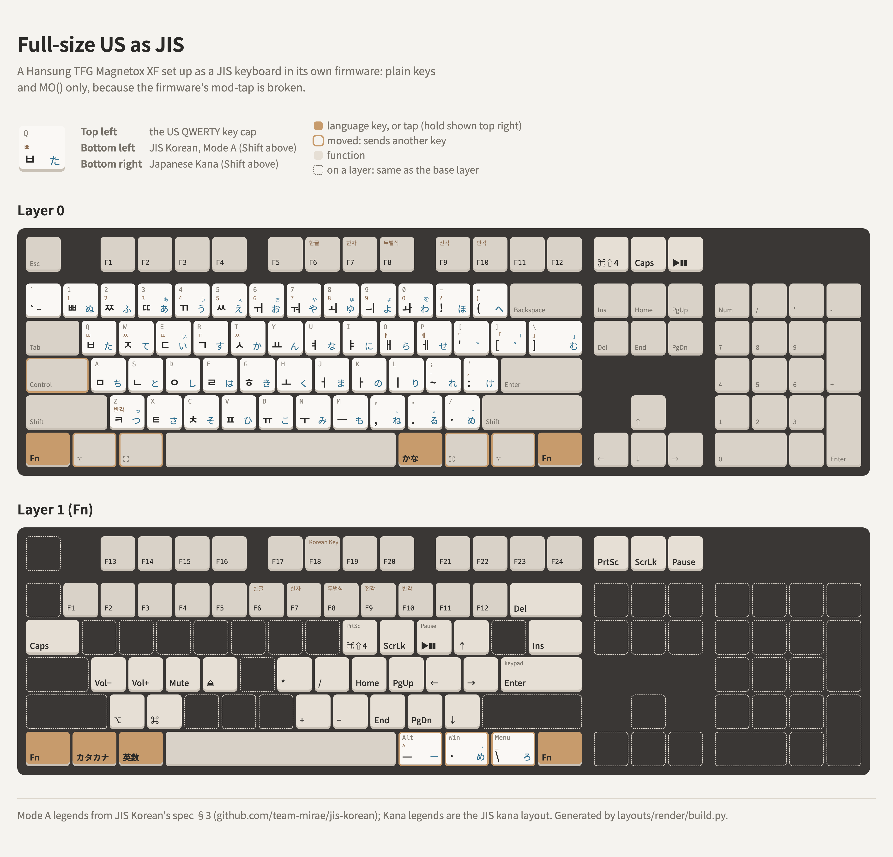

# A full-size US keyboard with JIS's keys, in firmware alone

A full-size (104-key) US ANSI keyboard set up as a JIS keyboard for macOS in its own firmware, with
no remapping software: カタカナ, 英数, かな, ¥ and ろ, plus F13–F24 and an HHKB-style Fn layer. It
uses only plain keys and `MO()`, because the board's firmware gets mod-tap wrong
([hansung/mod-tap-rshift-bug](../../hansung/mod-tap-rshift-bug/README.md)).

<picture>
  <source media="(prefers-color-scheme: dark)" srcset="layout-dark.png">
  
</picture>

Reference board: **Hansung TFG Magnetox XF**, firmware 5.9.2, edited with VIA's protocol
([via-definition-magnetox-xf](../../hansung/via-definition-magnetox-xf/README.md),
[viahid](../../via/raw-hid-keymap-editing/README.md)). The complete keymap, all four layers, is
[magnetox-xf.layout.json](magnetox-xf.layout.json), in VIA's saved-layout format, keys in matrix
order (7 × 16). Layers 2 and 3 are Hansung's defaults.

## Layer 0

Unchanged from a US board except:

| Key | Canonical name | Sends |
|---|---|---|
| Bottom row | `KeyUSLeftControl` · `KeyLeftPrimary` · `KeyLeftAuxiliary` · `KeySpacebar` · `KeyRightAuxiliary` · `KeyRightPrimary` · `KeyWINMenu` · `KeyRightControl` | `MO(1)` · ⌥ · ⌘ · Space · かな (`KC_LNG1`) · ⌘ · ⌥ · `MO(1)` |
| Caps Lock | `KeyCapsLock` | Control (HHKB-style) |
| Print Screen | `KeyPrintScreen` | ⌘⇧4 (`LSG(KC_4)`) |
| Scroll Lock / Pause | `KeyScrollLock` / `KeyPause` | Caps Lock / Play-Pause |

Other names: [Key names](../README.md#key-names).

## Layer 1 (Fn: hold either `MO(1)`)

| Fn + | Canonical name | Sends |
|---|---|---|
| Left ⌥ / left ⌘ | `KeyLeftPrimary` / `KeyLeftAuxiliary` (the Win and Alt caps) | **カタカナ** (`KC_INT2`) / **英数** (`KC_LNG2`) |
| The 3 keys right of Space | `KeyRightAuxiliary` · `KeyRightPrimary` · `KeyWINMenu` | **¥** (`KC_INT3`) · / · **ろ** (`KC_INT1`), as on the 87-key layout |
| Z / X | `KeyZ` / `KeyX` | ⌥ / ⌘, since the modifiers on the bottom row are taken by カタカナ and 英数 |
| F1 … F12 | `KeyFunctionOne` … `KeyFunctionTwelve` | F13 … F24 (Fn+F6 = F18) |
| 1 … 0, -, = | `KeyOne` … `KeyZero`, `KeyUSMinus`, `KeyUSEquals` | F1 … F12 |
| Backspace / `\` | `KeyDeleteLeft` / `KeyUSBackslash` | Delete / Insert |
| Tab | `KeyTab` | Caps Lock |
| I / O / P | `KeyI` / `KeyO` / `KeyP` | ⌘⇧4 / Scroll Lock / Play-Pause |
| [ ; ' / | `KeyUSLeftBracket` `KeyUSSemicolon` `KeyUSApostrophe` `KeyUSSlash` | ↑ ← → ↓ |
| K L , . | `KeyK` `KeyL` `KeyUSComma` `KeyUSPeriod` | Home, Page Up, End, Page Down |
| H J N M | `KeyH` `KeyJ` `KeyN` `KeyM` | keypad * / + − |
| Enter | `KeyUSEnter` | keypad Enter |
| A S D F | `KeyA` `KeyS` `KeyD` `KeyF` | volume down, volume up, mute, eject |
| Print Screen cluster | `KeyPrintScreen` `KeyScrollLock` `KeyPause` | Print Screen, Scroll Lock, Pause |

The Fn layer from 1 down is the HHKB US Fn layer, with the Mac extras (⌘⇧4 on I, Play/Pause on P).

## On the Mac

Store the keyboard as **JIS** in Keyboard Setup Assistant: press Z for the key right of the left
Shift, then Fn + the third key right of Space (ろ) for the key left of the right Shift. Then ¥ and
ろ type, and the board's US caps type JIS's keys by position: `[` `]` `\` are JIS's @ [ ], `=` is ^,
`'` is :.

## Choices

- **Language keys on Fn + modifiers, not tap vs hold.** On a board with working mod-tap, tap 英数 /
  hold ⌘ is nicer ([us-ansi-87-key-to-jis](../us-ansi-87-key-to-jis/README.md)). Here, mod-tap's
  taps carry the modifier, so 英数 would arrive as ⌘ + 英数.
- **One-tap カタカナ is possible:** `LT(1,KC_KANA)` (tap カタカナ, hold Fn) works on this firmware, on
  the bottom-left key instead of `MO(1)`. Layer-tap is fine; only mod-tap is broken.
- Only plain `KC_LNG2` gives 英数 on a Mac; 変換, 無変換 and LANG3–5 don't
  ([japanese-keycodes-on-macos](../../qmk/japanese-keycodes-on-macos/README.md)).
