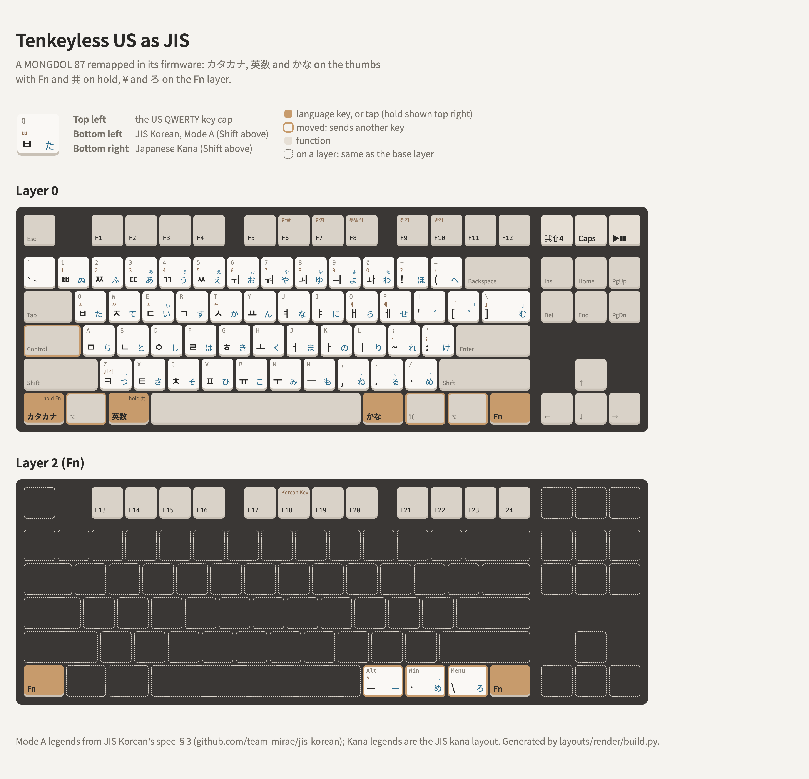

# A tenkeyless US keyboard with JIS's keys, in firmware

A remappable ANSI tenkeyless (87-key) keyboard set up as a JIS keyboard for macOS in its firmware,
on two layers: one key per language on the thumbs (カタカナ, 英数, かな, with Fn and ⌘ on hold),
¥ and ろ on the Fn layer, and F13–F24.

<picture>
  <source media="(prefers-color-scheme: dark)" srcset="layout-dark.png">
  
</picture>

Reference board: **MONGDOL 87 BT-1**, remapped in VIA. Its keymap is
[mongdol_87.layout.json](mongdol_87.layout.json) (layers 0 and 2 are the ones used; on that board,
Windows mode makes layer 0 the default). The drawing is [layout.html](layout.html). The full guide, for
[JIS Korean](https://github.com/team-mirae/jis-korean), is
[docs/mac-ansi-87-key-recommended](https://github.com/team-mirae/jis-korean/tree/main/docs/mac-ansi-87-key-recommended).

## Layer 0

| Key | Keycode | Tap | Hold |
|---|---|---|---|
| Bottom-left | `LT(2,KC_KANA)` | カタカナ (0x88) | Fn |
| Second | `KC_LALT` | ⌥ | |
| Left of Space | `MT(MOD_LGUI,KC_HANJ)` | 英数 (LANG2) | ⌘ |
| Right of Space | `KC_HAEN` | かな (LANG1) | |
| Next two | `KC_RGUI`, `KC_RALT` | ⌘, ⌥ | |
| Rightmost | `MO(2)` | | Fn |
| Caps Lock | `KC_LCTL` | | Ctrl (HHKB-style; swapping it with bottom-left works too) |

## Layer 2 (Fn)

| Key | Keycode |
|---|---|
| F1 … F12 | `KC_F13` … `KC_F24` |
| The 3 keys right of Space | `KC_JYEN` (¥), `KC_SLSH`, `KC_RO` (ろ) |

## On the Mac

Store the board as **JIS** with Keyboard Setup Assistant: Z for the key right of the left Shift,
then Fn + the third key right of Space (ろ) for the key left of the right Shift; or skip and pick
JIS. If that doesn't work, keep it ANSI and let Karabiner-Elements pass it through its virtual
keyboard stored as JIS (Modify events and Ignore vendor events on for the board, `593-1452-0` = 42).
See [keycap-legend-language-and-jis](../../via/keycap-legend-language-and-jis/README.md) for how
it went on the reference board.

The ANSI caps then type JIS's keys by position: `[` `]` `\` are @ [ ], `=` is ^, `'` is :.

## Alternatives, not chosen

- **ろ on `` ` ``** (`KC_RO` left of 1; katakana keycap sets often have an R1 ロ for it): a kana key
  without Fn, but it trains the left hand for ろ, which JIS has at the right end of the bottom row.
- **The number row shifted one key left** (`` ` `` sends 1 … `-` sends `=`), freeing the key left of
  Backspace for ¥ as on JIS. It matches only a MacBook JIS, whose number row starts at 1, and puts
  the digits one key off on every other keyboard.
